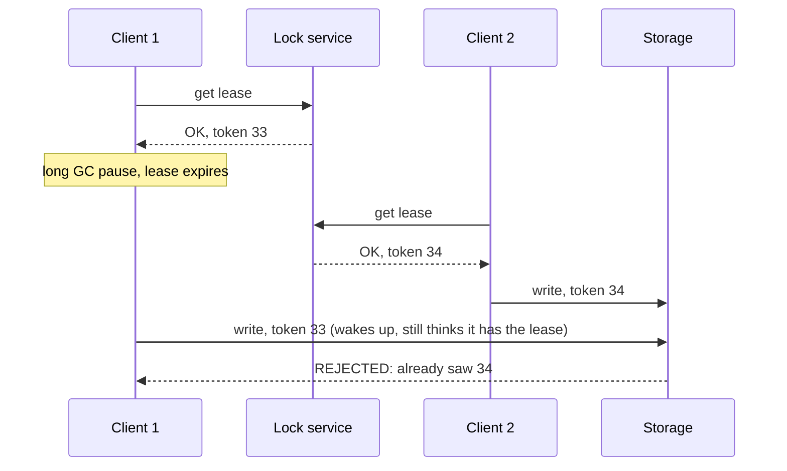

# Timeouts, clocks and fencing tokens

## Dead or just slow?

```text
response time of a healthy node:  10 ms, 11 ms, 9 ms, 12 ms, ... 4,800 ms (a GC pause), 10 ms ...
```

| Timeout | Healthy nodes declared dead | Time to notice a real crash |
|---|---|---|
| Short | Many: every pause looks like a crash | Fast |
| Long | Few | Slow: users wait |

Declaring a node dead is not free: its work moves to other nodes, which adds load, which slows them, which can make
**them** look dead. A good timeout comes from measuring real response times, not from guessing.

## Why last write wins loses writes

```text
real time:      42.0040 s  client A writes x = 1   (on node 1, clock correct)
                42.0055 s  client B writes x = 2   (on node 3, clock 2.5 ms slow)
timestamps:     A: 42.0040   B: 42.0030
LWW keeps the larger timestamp: x = 1. Client B's later write vanishes, with no error.
```

Clock skew of a few milliseconds is **good** synchronization in practice, and it's still enough to reorder writes that
happen close together. Order events with logical clocks (next chapter), not wall clocks.

## The paused lease holder



The client can't protect itself: it was paused at the worst moment and doesn't know it. The **storage** must check:
every lease comes with a **fencing token** that always increases, and storage refuses any write with a token older
than one it has already accepted.

## Safety and liveness

- **Safety**: nothing bad ever happens ("there are never two leaders"). Must hold always, even during faults.
- **Liveness**: something good eventually happens ("a leader is eventually elected"). May wait until the network
  calms down.

## What to take away

- Timeouts trade false alarms for slow detection; measure, don't guess.
- Wall-clock timestamps can silently drop writes.
- Fencing tokens make the resource, not the client, decide who is current.
