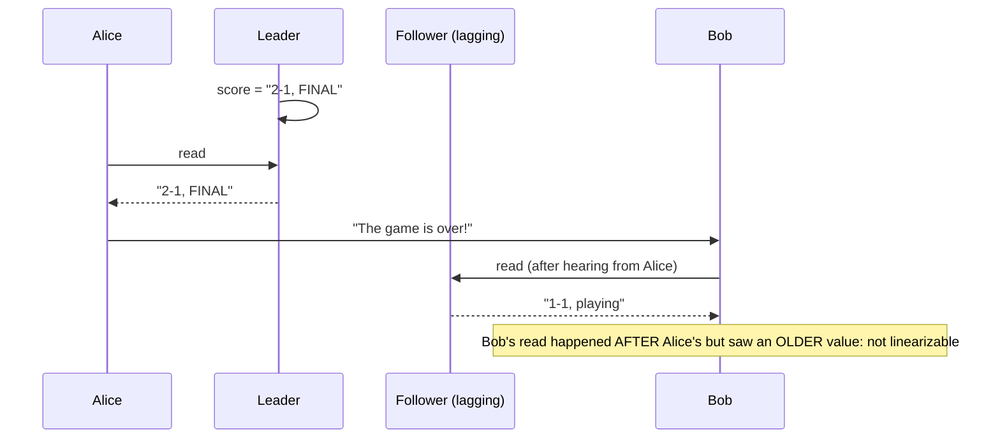

# Linearizability, Lamport clocks, 2PC and majority votes

## Linearizability in one picture



A linearizable system behaves as if there were **one copy** of the data: after any read returns the new value, all
later reads return it too, whichever replica serves them.

## Lamport timestamps

Each node keeps a counter. On every operation: counter + 1. Every message carries the sender's counter; the receiver
jumps to `max(own, received)` first. A timestamp is the pair `(counter, node id)`.

```text
node 1: (1,1) create 'mona'  -> sends message stamped (2,1)
node 3: (1,3) create 'mona'           (never heard from node 1)
node 2: receives (2,1), jumps to 2, then (3,2) edit
order:  (1,1) < (1,3) < (2,1) < (2,3) < (3,2)    ties broken by node id
```

The order respects causality (node 2's edit comes after the message it read). But node 3 couldn't know, when its user
clicked "create", that a smaller timestamp for 'mona' existed elsewhere. To decide **right now**, a node needs every
operation delivered to every node in the same order: **total order broadcast**, which is consensus.

## Two-phase commit and the blocking problem

```text
Phase 1 (prepare): coordinator -> all: "can you commit?"   each replies "yes" (and promises to) or "no"
Phase 2 (commit):  coordinator decides, writes the decision to its log, tells everyone

coordinator crashes after the "yes" votes, before phase 2:
  participants: "prepared", rows locked, can't decide alone       -> IN DOUBT until it comes back
```

## Consensus by majority

```text
5 nodes, a majority is 3.
partition: {1, 2} | {3, 4, 5}
  side {1,2}:   at most 2 votes  -> can never elect a leader
  side {3,4,5}: 3 votes          -> elects a leader for a new term
two majorities of the same 5 nodes always share at least one node, so two leaders can't win the same term.
```

Raft, Paxos, Zab and Viewstamped Replication all build on two ideas: **terms (epochs)** that only go up, and
**majority votes** that must overlap. A leader from an old term that comes back is outvoted.

## What to take away

- Linearizable = looks like one copy; stale replicas break it.
- Lamport timestamps order events consistently with causality, but can't make decisions on the spot.
- 2PC blocks when its coordinator fails; consensus by majority keeps working while a majority is up.
