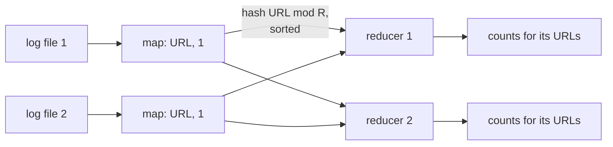

# MapReduce and joins, step by step

## The Unix pipeline

```bash
cat access.log | awk '{print $7}' | sort | uniq -c | sort -r -n | head -n 5
```

| Step | Does |
|---|---|
| `awk '{print $7}'` | Takes the 7th field of each line: the URL |
| `sort` | Puts equal URLs next to each other (can spill to disk for huge inputs) |
| `uniq -c` | Counts each run of equal lines |
| `sort -r -n` | Sorts by count, biggest first |
| `head -n 5` | Keeps the top 5 |

## The same thing as MapReduce



1. **Map**: each mapper reads one input file and emits `(key, value)` pairs.
2. **Partition**: each pair goes to reducer `hash(key) mod R`, so **every pair with the same key ends up at the same
   reducer**.
3. **Sort**: each mapper writes one **sorted** file per reducer.
4. **Shuffle**: each reducer fetches its file from every mapper.
5. **Reduce**: the reducer merges its sorted files (a merge sort, like an SSTable compaction) and gets all values of
   one key together.

## Sort-merge join (reduce side)

```text
mapper over activity events:  key = user_id, value = ("view", url)
mapper over the users table:  key = user_id, value = ("user", birth_year)
reducer for user 42 receives: ("user", 1990), ("view", "/"), ("view", "/blog"), ...
                              -> emits ("born 1990s", 1) for each view
```

Both sides are keyed and partitioned the same way, so matching records meet in one reducer. It works for any size,
and pays for a full shuffle of both inputs.

## Broadcast hash join (map side)

If one side is small (a 5,000-row users table), load it into a hash table **in every mapper**, and look each event up
as it streams past. No shuffle, no reducers. It only works when the small side fits in memory.

## Why batch output should be immutable

A batch job reads its input and writes **new** output, never changing the input. If the code had a bug: fix it and
rerun, and the old output can be thrown away. The book calls this **human fault tolerance**. A job that updated a
production database row by row would offer no such second chance.

## What to take away

- MapReduce generalizes `sort | uniq -c` to many machines: partition by key, sort, merge.
- Sort-merge joins handle any sizes, at the cost of a shuffle; broadcast joins skip it when one side is small.
- Immutable inputs and rerunnable jobs make batch processing forgiving.
