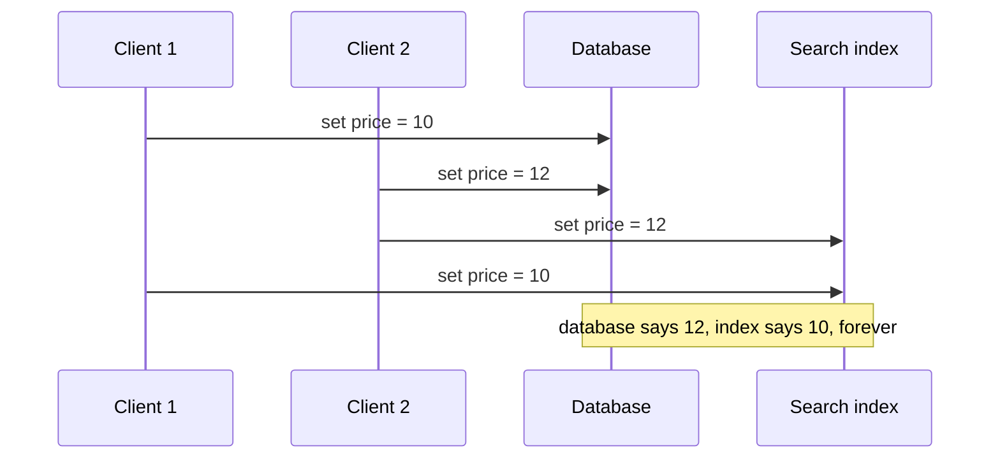

# Logs, offsets, CDC and stream joins

## A partitioned log

```text
topic "page-views"
partition 0:  [0] u7 /      [1] u3 /cart  [2] u7 /books  [3] ...      <- append only
partition 1:  [0] u2 /      [1] u2 /books [2] ...
partition 2:  [0] u9 /cart  ...

key = user id -> hash(key) mod 3 picks the partition: one user's events stay in order
consumer group "counter" remembers: {partition 0: offset 2, partition 1: offset 1, partition 2: offset 1}
```

Reading doesn't remove anything. A new consumer can start at offset 0 and replay history; a crashed one restarts from
its last **committed** offset.

## At-least-once, and idempotence

```text
process message 41, process message 42 ... crash before committing offset 42
restart from the last committed offset (40)  -> 41 and 42 are processed AGAIN
```

You can't make delivery happen exactly once. You can make the **effect** happen once: make processing idempotent,
for example by remembering each message's ID with the result, in the same transaction, and skipping IDs already seen.

## Why dual writes diverge



Each system got both writes, in a different order. Nothing will ever notice. With **change data capture**, the
application writes only to the database; the index applies the database's own change log, in the database's order, so
it always ends up the same.

## Stream-table join

```text
changelog:  t=0  user 7 country=Egypt     t=95 user 7 country=Morocco
clicks:     t=30 user 7   -> joined with Egypt
            t=120 user 7  -> joined with Morocco
```

The processor keeps a local copy of the table, updated from the changelog, and joins each event with the table **as it
was at that moment**. Run the same join later against today's table and you'd get a different, wrong answer for the
older clicks.

## Window types

| Window | Example |
|---|---|
| Tumbling | 10:00-10:01, 10:01-10:02: each event in exactly one |
| Hopping | 5-minute windows starting every minute: overlapping, fixed |
| Sliding | "Events within 5 minutes of each other" |
| Session | A user's activity until 30 minutes of inactivity |

## What to take away

- Logs keep history; offsets make consumers restartable; restarts mean duplicates.
- Idempotent processing gives an exactly-once effect.
- One ordered log beats several independent writes.
