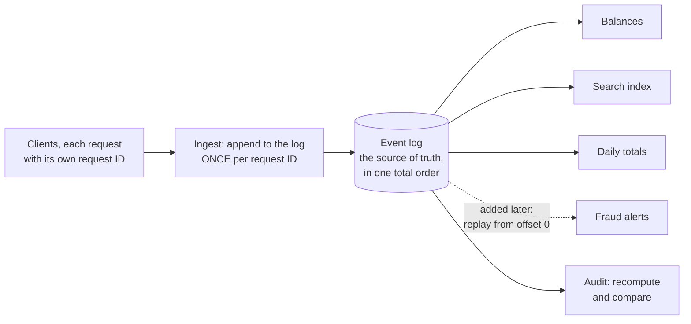

# The unbundled database: one log, many views

## The shape



Each view is **derived**: a function of the log. That gives you three powers a single database doesn't:

1. **Add a view at any time** by replaying the log from the start. No migration of the existing views.
2. **Rebuild a broken view**: throw it away and replay. Bugs in derived data are recoverable.
3. **Audit**: recompute and compare. "Trust, but verify."

## Exactly once, end to end

```text
client: transfer 100, request_id = 7f3c...    -> timeout, no answer
client: transfer 100, request_id = 7f3c...    -> retry, same id
server: is 7f3c... already in the log?  yes -> don't append again
```

TCP retries, database transactions and stream processors each suppress duplicates **within their own layer**. Only
the endpoint that started the operation knows that two requests are the same operation, so only an ID chosen there
can suppress duplicates **end to end**. This is the end-to-end argument.

## Timeliness and integrity

| | Timeliness | Integrity |
|---|---|---|
| Means | Users see an up-to-date state | No data is lost, corrupted or contradictory |
| If violated | Wait a moment and it's fixed | Permanent damage, until someone notices |
| Example | A transfer shows up 2 s later | Money disappears from a balance |

Event logs with idempotent consumers give **integrity** without distributed transactions: every event is applied
exactly once, in order, eventually. Timeliness is the part you can sometimes relax.

## What to take away

- A log plus derived views gives reprocessing, rebuilding and auditing for free.
- Request IDs made by the client are what make retries safe end to end.
- Protect integrity first; relax timeliness where the business allows.
