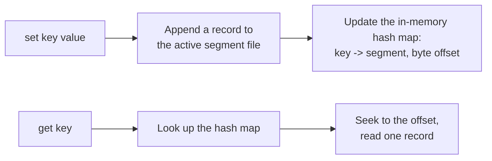

# A log-structured store, piece by piece



## The record format

```text
| crc32 (4 bytes) | key length (2) | value length (4) | key bytes | value bytes |
```

- Lengths first, so a reader knows where the record ends without searching for a separator. Keys and values can
  contain any bytes, even newlines.
- A **checksum** over the content. If the machine loses power halfway through a write, the last record is
  incomplete; on restart its checksum doesn't match, and recovery ignores it.
- A special value length (here `0xFFFFFFFF`) marks a **tombstone**: "this key was deleted".

## Segments and compaction

```text
segment 1: a=1 b=1 a=2 c=1 a=3          (full, closed)
segment 2: b=2 a=4 c=2                  (full, closed)
segment 3: d=1 ...                      (active, still being written)

compact segments 1 and 2 -> a=4 b=2 c=2   (only the latest value of each key)
```

Closed segments are never modified, so compaction can run in a background thread while reads and writes continue on
the old files. When the merged file is complete, reads switch to it and the old files are deleted.

Careful: a key whose newest value is in the **active** segment must not be resurrected from an old one. Today's code
checks the index for that.

## Crash recovery

The hash map lives in memory, so a restart loses it. To rebuild it, read every segment from oldest to newest and
record each key's latest offset. This is slow for big stores, which is why Bitcask also saves a snapshot of each
segment's hash map ("hint files").

## Why not overwrite in place?

| Append-only log | Update in place |
|---|---|
| Sequential writes: fast on disks and SSDs | Random writes |
| A crash leaves at most one broken record, at the end | A crash mid-write can leave a mix of old and new bytes |
| Old values stay until compaction | Space reused immediately |
| Needs compaction | Needs free-space management |

## What to take away

- Length-prefixed records with a checksum make a log safe to read after a crash.
- Compaction keeps the log from growing forever, and runs without blocking writes.
- The index lives in memory, so it must be rebuilt (or reloaded) after a restart.
