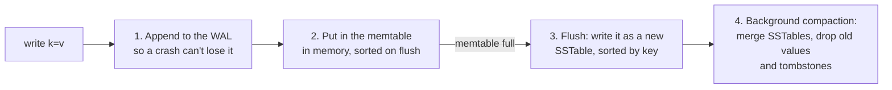
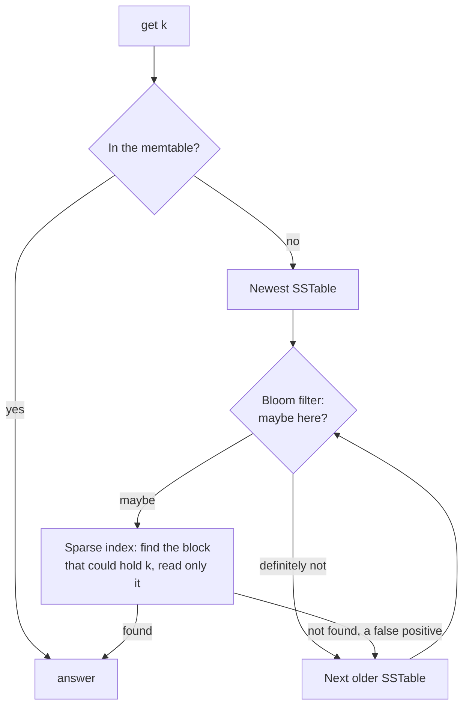

# How an LSM-tree reads and writes

## The write path



## The read path



## Sparse index

```text
sparse index (in memory)        SSTable on disk (sorted)
"apple"   -> offset 0           apple, apricot, avocado, banana, ..., cherry,
"cherry"  -> offset 4096        cherry, coconut, date, ...,
"grape"   -> offset 8192        grape, guava, ...
```

To find "date": it's between "cherry" and "grape", so read the block starting at 4096. You keep one key per block in
memory, not every key.

## Bloom filter in one paragraph

A bit array and k hash functions. Adding a key sets k bits. Checking a key looks at its k bits: if **any** is 0, the
key was never added; if all are 1, it **may** have been (other keys could have set those bits). So the answer
"definitely not here" is exact, and "maybe" is occasionally wrong: a **false positive**, which only costs one wasted
read. With about 10 bits per key and a few hash functions, false positives are around 1%.

## LSM-tree versus B-tree

| | LSM-tree | B-tree |
|---|---|---|
| Writes | Sequential appends and flushes | Overwrite pages in place, plus the WAL |
| Reads | May check several SSTables | One path from root to leaf |
| Space | Compresses well; old values until compaction | Some pages partly empty after splits |
| Range queries | Merge sorted files | Walk neighbouring leaf pages |
| Watch out for | Compaction competing with traffic | Write amplification of whole-page writes |
| Used in | RocksDB, LevelDB, Cassandra, HBase | PostgreSQL, MySQL InnoDB, SQLite |

## Write amplification

One application write is written to disk several times: once to the WAL, once when the memtable is flushed, and once
more each time compaction rewrites it. Today's project measures it: bytes written to disk divided by bytes the
application wrote.

## What to take away

- Writes: WAL, memtable, flush to sorted files, compact later.
- Reads: memtable, then SSTables newest first; Bloom filters skip files; sparse indexes skip blocks.
- No engine wins at everything: measure your own workload.
