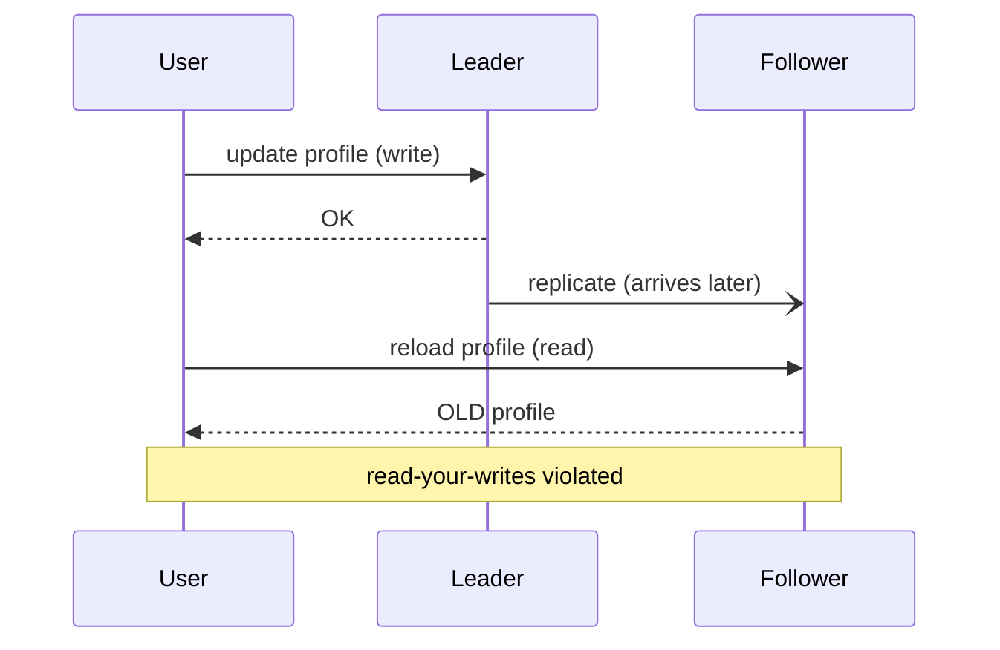

# Replication lag and quorums, pictured

## Asynchronous replication



The write was acknowledged before the follower had it. Usually the lag is milliseconds; under load, or while a follower
catches up, it can be seconds or minutes.

## Three guarantees, and how to provide them

| Guarantee | Means | One practical way |
|---|---|---|
| **Read your own writes** | You always see what you wrote | Read data the user may have just changed from the leader (for example for a minute after their last write) |
| **Monotonic reads** | Time never goes backwards for one user | Always send each user to the same replica (for example chosen by a hash of their ID) |
| **Consistent prefix reads** | You never see an answer before its question | Write causally related data to the same partition |

## Failover loses acknowledged writes

```text
leader's log:    1 2 3 4 5 6 7 8 9 10       (all acknowledged to users)
follower A:      1 2 3 4 5 6 7              <- most up to date
follower B:      1 2 3 4 5

leader dies; A is promoted. Writes 8, 9, 10 are gone, though users were told "done".
```

The new leader then hands out IDs that the old leader had already used, which is how the GitHub incident in the
book exposed private data.

## Quorums

```text
n = 3 replicas: A B C
write to w = 2:   A=v2  B=v2  C=v1(missed it)
read from r = 2:  any 2 of A, B, C includes at least one v2   -> take the highest version
                  because w + r = 4 > 3, the sets must overlap
```

With w = 1 and r = 1, a read can easily hit a replica the write didn't reach. Quorums trade latency (wait for more
replicas) for freshness.

**Read repair**: when a read sees an older version on one replica, it writes the newer one back. Replicas that are
rarely read stay stale until a background **anti-entropy** process compares and fixes them.

## What to take away

- Acknowledge-then-replicate is fast and creates lag; lag breaks user-visible guarantees.
- Each guarantee has a simple practical fix.
- w + r > n makes reads overlap writes, but quorums are not a full consistency guarantee.
