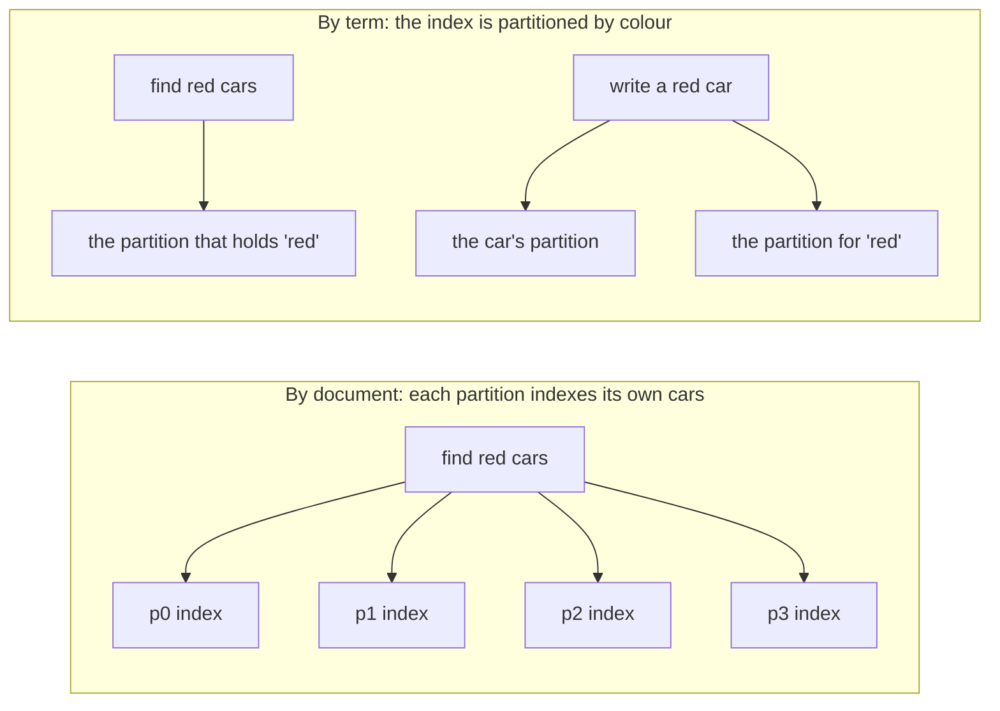

# Partitioning: spreading data, and moving it later

## Key range versus hash

```text
Key range: partition by the key's position in sorted order
  p0: a..f   p1: g..m   p2: n..s   p3: t..z
  + "all keys from 'sm' to 'sp'" asks one partition
  - keys that arrive in order (timestamps!) all hit the last partition

Hash: partition by hash(key)
  hash("2026-11-24T10:00:01") -> p2, hash("2026-11-24T10:00:02") -> p0, ...
  + writes spread evenly
  - "everything from 10:00 to 10:10" asks all partitions
```

A common middle way is a **compound key**: hash the first part (a sensor ID, a user ID) to pick the partition, and
sort by the second part (the time) inside it. One sensor's readings stay together and in order; different sensors
spread out.

## Why not hash mod N?

```text
hash(key) = 1,000,003
mod 4 = 3      mod 5 = 3     stays
hash(key) = 1,000,004
mod 4 = 0      mod 5 = 4     moves
```

Change N and almost every key's result changes: adding one node to four moves about 80% of the data. Instead, create
**many more partitions than nodes** at the start (say 256 for 4 nodes, 64 each). Keys never change partition; only
**whole partitions** move. A new fifth node takes about 51 partitions from the others: about 20% of the data moves,
the minimum possible.

## Secondary indexes



| | Local index | Global index |
|---|---|---|
| Write a document | One partition | The document's partition plus the index partitions of its terms |
| Read by indexed value | **All** partitions (scatter/gather) | One partition per term |
| Freshness | Updated with the document | Often updated asynchronously: briefly stale |

## Hot keys

Hashing can't help when one key is the hot spot (a celebrity, a viral post): all its traffic goes to one partition.
Split it by appending a random number, `post:123#07`, so writes spread over 100 keys, and make every read gather all
100. Do it only for the few keys that need it.

## What to take away

- Choose the partition key from your queries: ranges keep order, hashes spread load.
- Fix the number of partitions up front, much larger than the number of nodes.
- Every secondary index choice moves work between reads and writes.
