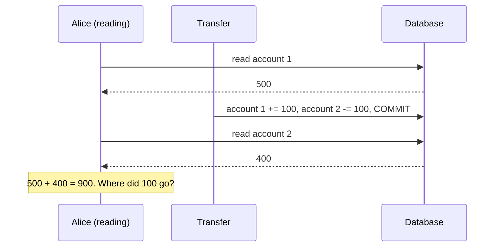

# Isolation levels, and the anomaly each one stops

## Read skew under read committed



Every read saw committed data, so read committed is satisfied, and the total is still wrong. **Snapshot isolation**
fixes it: Alice's transaction reads everything **as of the moment it began**, so she sees 500 + 500.

## How MVCC gives each transaction its snapshot

```text
account 2 versions:   (committed at t=0) 500    (committed at t=3) 400
Alice's transaction began at t=1:  sees versions committed at or before t=1  -> 500
a transaction that begins at t=4:   sees -> 400
```

Old versions are kept until no running transaction can need them. Readers never block writers, and writers never
block readers.

## Lost update

```text
A: read counter = 0            B: read counter = 0
A: write counter = 1           B: write counter = 1
A: commit                      B: commit            -> counter = 1, one increment lost
```

Fixes: an atomic `UPDATE ... SET counter = counter + 1`, a lock on the row, or **automatic detection**: at commit, if
someone else committed a write to the same row since my snapshot, abort me ("first committer wins"), and the
application retries.

## Write skew: why snapshot isolation isn't enough

```text
Rule: at least one doctor must be on call.
Alice: count on-call doctors = 2 (her snapshot)   -> "fine, I'll leave"  -> set alice off
Bob:   count on-call doctors = 2 (his snapshot)   -> "fine, I'll leave"  -> set bob off
Both commit. They wrote DIFFERENT rows, so no write-write conflict was detected. On call: 0.
```

The pattern: read something, decide based on it, write **something else**. When both commit, the premise of each
decision is false. **Serializable snapshot isolation** tracks what each transaction **read**; at commit, if any of it
was changed by a transaction that committed meanwhile, it aborts.

## The summary table

| Anomaly | Read committed | Snapshot isolation | Serializable |
|---|---|---|---|
| Dirty read / dirty write | Prevented | Prevented | Prevented |
| Read skew | **Possible** | Prevented | Prevented |
| Lost update | **Possible** | Prevented if the database detects it (PostgreSQL does; MySQL InnoDB doesn't) | Prevented |
| Write skew, phantoms | **Possible** | **Possible** | Prevented |

## What to take away

- MVCC gives each transaction a consistent snapshot by keeping old versions.
- First-committer-wins stops lost updates on the same object.
- Write skew involves different objects, so only serializability stops it.
