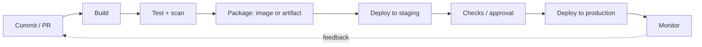

# What DevOps and CI/CD actually mean

**DevOps** is a way of working where the people who build software also own how it is shipped and run, with automation replacing hand-offs and manual steps.

| Term | Means | Done right |
|---|---|---|
| **Continuous Integration (CI)** | Everyone merges small changes to the main branch often; every change is built and tested automatically | Main is always green |
| **Continuous Delivery** | Every green build *can* be released with one click | Releasing is boring |
| **Continuous Deployment** | Every green build *is* released automatically | Needs strong tests and safe rollout |

## Where this course starts

Your **GitHub Actions and CLI** course taught workflows, jobs, triggers and the `gh` tool. This course is about **pipeline design**: what goes in each stage, how artifacts move, how secrets reach the cloud without keys, how to release safely, and how to roll back.

## How to tell if it's working: the DORA metrics

| Metric | Elite teams (roughly) |
|---|---|
| Deployment frequency | On demand, many times a day |
| Lead time for changes (commit to production) | Under a day |
| Change failure rate | Low (well under a third of deploys need a fix) |
| Time to restore service | Under an hour |

Speed and stability go **together**: small, frequent changes are easier to test, review and roll back than big ones.

The optional MIT Missing Semester lecture covers build systems, dependencies and CI from first principles.

## Optional videos

The lesson above is complete on its own. These go deeper, if you like learning by watching.

**MIT Missing Semester: Metaprogramming (build systems, dependencies, CI)**

https://www.youtube.com/watch?v=_Ms1Z4xfqv4
