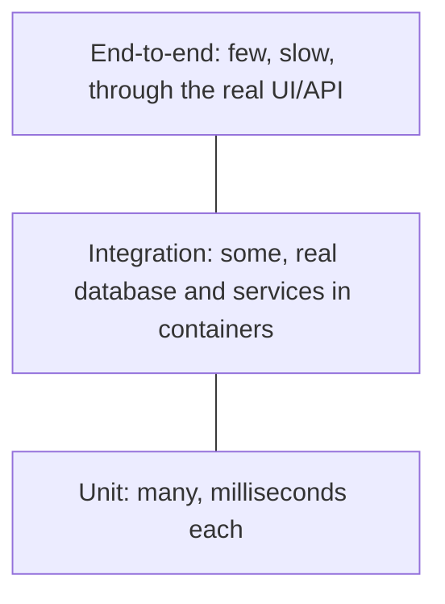

# Testing strategy and security scanning

## The test pyramid



Most bugs should be caught by fast unit tests; a handful of end-to-end tests prove the main user journeys work. An upside-down pyramid (mostly E2E) makes CI slow and flaky.

## Security in the pipeline ("shift left")

| Check | Finds | Example tools |
|---|---|---|
| **Secret scanning** | Keys and passwords committed by mistake | GitHub secret scanning + push protection, gitleaks |
| **Dependency scanning (SCA)** | Libraries with known vulnerabilities | Dependabot, `pip-audit`, `npm audit`, Trivy |
| **Static analysis (SAST)** | Risky code patterns (SQL injection, unsafe deserialisation) | CodeQL, Semgrep, Bandit |
| **Container image scanning** | Vulnerable OS packages in your image | Trivy, Grype |
| **IaC scanning** | Public buckets, open security groups in Terraform | Checkov, tfsec/Trivy config |

```yaml
      - uses: aquasecurity/trivy-action@0.28.0
        with:
          scan-type: fs
          severity: CRITICAL,HIGH
          exit-code: "1"
          ignore-unfixed: true
```

## Don't drown the team

- Fail the build on **critical and high** issues that **have a fix**; report the rest.
- Keep an allowlist with an expiry date and a reason for each accepted risk.
- Turn on **Dependabot** (or Renovate) so fixes arrive as small PRs that CI tests automatically.
