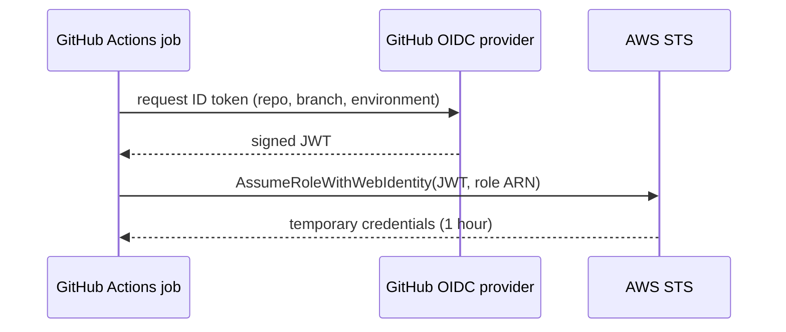

# Secrets in pipelines, and OIDC to the cloud

## GitHub secrets basics

- **Repository / environment / organisation secrets**, read as `${{ secrets.NAME }}`; masked in logs.
- Secrets are **not** passed to workflows triggered by pull requests **from forks**.
- Never `echo` a secret, write it to an artifact, or pass it on a command line other processes can see.

## Stop storing cloud keys: OIDC

Long-lived `AWS_ACCESS_KEY_ID` secrets in CI are a top source of breaches. With **OIDC**, GitHub gives each job a short-lived signed token; AWS trusts GitHub's identity provider and swaps the token for temporary credentials for **one role**.



```yaml
permissions:
  id-token: write
  contents: read
steps:
  - uses: aws-actions/configure-aws-credentials@v4
    with:
      role-to-assume: arn:aws:iam::123456789012:role/gha-deploy-prod
      aws-region: eu-central-1
  - run: aws sts get-caller-identity
```

The role's **trust policy** limits who can assume it, down to repo and environment:

```json
"Condition": {
  "StringEquals": {"token.actions.githubusercontent.com:aud": "sts.amazonaws.com"},
  "StringLike": {"token.actions.githubusercontent.com:sub": "repo:acme/shop:environment:production"}
}
```

Without the `sub` condition, **any** GitHub repository could assume your role. Always set it.
