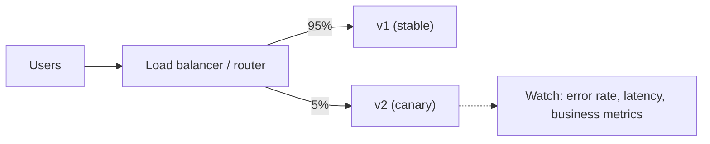

# Deployment strategies

| Strategy | How | Rollback | Cost | Risk |
|---|---|---|---|---|
| **Recreate** | Stop old, start new | Redeploy old | Low | Downtime |
| **Rolling** | Replace instances/pods a few at a time | Roll forward or back gradually | Low | Old and new run together for a while |
| **Blue-green** | Full new copy (green) next to old (blue); switch traffic at once | Switch back instantly | 2x during deploy | Database changes must suit both |
| **Canary** | Send a small % of traffic to new; watch; increase | Send 0% to new | Small extra | Needs good metrics |
| **Feature flags** | Code deployed off; switched on per user group | Turn the flag off | None | Flag debt |

## Where you'll meet them

- **EC2 Auto Scaling**: instance refresh = rolling (Cloud Linux Administration).
- **Kubernetes**: Deployments are rolling by default (`maxSurge`, `maxUnavailable`); Argo Rollouts or Flagger add canary and blue-green.
- **AWS**: ALB weighted target groups, CodeDeploy blue/green, Lambda aliases with weights.
- **DNS**: Route 53 weighted records (slow: caches).

## Choosing

Start with **rolling + good health checks + fast rollback**. Add canary when you have metrics you trust and traffic big enough to see problems in 5%. Blue-green when you need an instant switch and can afford double capacity.

## Optional videos

The lesson above is complete on its own. These go deeper, if you like learning by watching.

**TechWorld with Nana: GitLab CI/CD full course (pipelines, stages, deploying)**

https://www.youtube.com/watch?v=qP8kir2GUgo
