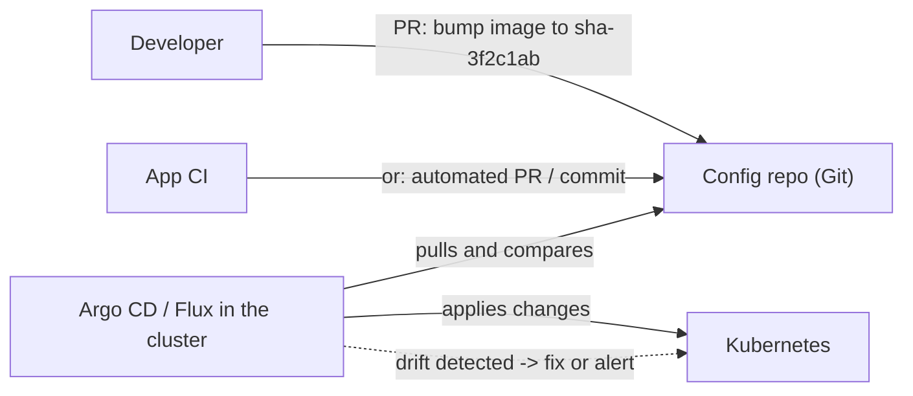

# GitOps

**GitOps**: the desired state of your environments lives in Git, and an agent **in the cluster** pulls it and makes reality match. Nobody runs `kubectl apply` by hand.



| Push-based CD | GitOps (pull-based) |
|---|---|
| CI job has cluster credentials and runs `kubectl`/`helm` | Only the in-cluster agent has rights; CI never touches the cluster |
| What's running = whatever the last job did | What's running = what Git says |
| Rollback: rerun an old job | Rollback: `git revert` |
| Manual changes stay unnoticed | **Drift** is detected and reverted or reported |

## Typical layout

```text
shop-config/
  apps/shop/base/            # Kubernetes manifests or Helm chart values
  apps/shop/overlays/staging/kustomization.yaml   # image: sha-3f2c1ab
  apps/shop/overlays/prod/kustomization.yaml      # image: sha-9e81d02
```

The app's CI builds and pushes the image, then opens a PR (or commits) to bump the tag in `staging`. Promotion to prod is another PR, reviewed and merged: an audit trail for free.

```bash
argocd app list
argocd app diff shop-prod
argocd app sync shop-prod
```

GitOps fits Kubernetes best; for EC2/Terraform the same ideas apply with Terraform runs triggered from Git (Infrastructure as Code course).
