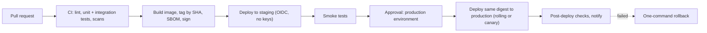

# Capstone: a complete delivery pipeline

Build a pipeline for a small web app (yours, or any Python/Node app with tests and a Dockerfile).

## Requirements

1. Protected `main` with required checks; trunk-based, small PRs.
2. CI under 10 minutes with caching; tests use a real database in a service container.
3. Secret scanning, dependency and image scanning that fails on fixable critical/high issues.
4. Image tagged with the commit SHA, pushed to a registry, with an SBOM (signing is a stretch goal).
5. Deploy target of your choice (EC2 ASG, Kubernetes with GitOps, ECS, or a VPS over SSH) using **OIDC or a deploy key**, no long-lived cloud keys.
6. `staging` and `production` environments; production needs approval and only deploys from `main`.
7. Smoke tests after each deploy; a documented, tested rollback.
8. Hardening: actions pinned by SHA, least `permissions`, no secrets in logs.

## Deliverables

- The repository link and a screenshot of a full run.
- A one-page **pipeline README**: the stages, how to deploy, how to roll back, how secrets work.
- Your DORA baseline: how often you deployed this week and your lead time.

Then break it on purpose: merge a change that fails the smoke test and show the rollback.
