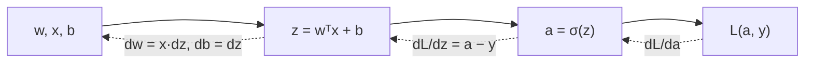

# The computation graph and the chain rule

Write the computation as a graph of small steps, forward from inputs to the cost. Then go **backward**: each step's
derivative is its local slope times the derivative coming from the step after it (the **chain rule**).

The neat result for logistic regression: `dz = a − y`. Then `dw = x·dz` and `db = dz`.

**This is exactly what autograd does.** PyTorch records the graph as your code runs, and `loss.backward()` walks it
backwards. TensorFlow's `tf.GradientTape` does the same.
