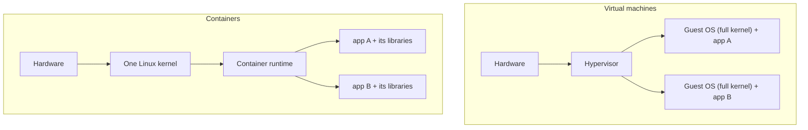

# Why containers exist

"It works on my machine" is the oldest problem in software. Your app needs Python 3.12, these 40 libraries at these versions, a certain OpenSSL, some environment variables, and a database. The server has something slightly different, and it breaks.

A **container** packages an app **with everything it needs to run** (its files, libraries, runtime and settings) and runs it isolated from everything else on the machine. The same container runs the same way on your laptop, a teammate's Mac, a CI server and a cloud VM.

## Containers vs virtual machines

| | Virtual machine | Container |
|---|---|---|
| Contains | A whole OS with its own kernel | Just the app and its user-space files |
| Size | Gigabytes | Megabytes |
| Starts in | Tens of seconds to minutes | Under a second |
| Isolation | Strong (separate kernel) | Good, but they share the host's kernel |
| Typical use | Different OSes, strong separation | Packaging and running apps |

They're not rivals: in the cloud, containers usually run **inside** VMs.

## Words you'll use every day

| Word | Is | Like |
|---|---|---|
| **Image** | A read-only package: files plus settings for how to start | A class, or an installer |
| **Container** | A running (or stopped) instance of an image | An object, or the installed program running |
| **Registry** | A server that stores images | GitHub, but for images (Docker Hub, GHCR, ECR) |
| **Dockerfile** | The recipe that builds an image | A build script |

The optional talk below is from 2013, when Docker's creator first showed it to the world in five minutes. Then Nana's full course is a great companion for this whole course.

## Optional videos

The lesson above is complete on its own. These go deeper, if you like learning by watching.

**Solomon Hykes (Docker's creator), PyCon 2013: The future of Linux containers**

https://www.youtube.com/watch?v=9xciauwbsuo

**TechWorld with Nana: Docker tutorial for beginners, full course**

https://www.youtube.com/watch?v=3c-iBn73dDE
