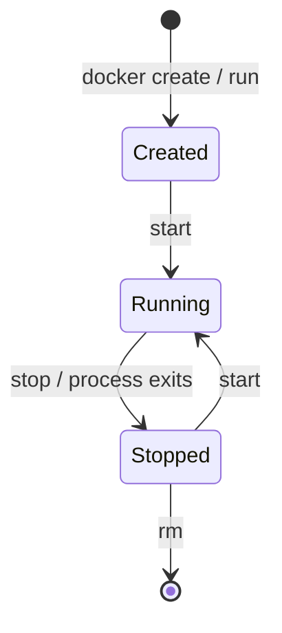

# Your first containers

Install **Docker Engine** (Linux) or **Docker Desktop** (Windows, Mac), then:

```bash
docker run hello-world
docker run -it --rm ubuntu:24.04 bash      # a shell inside a fresh Ubuntu; --rm deletes it when you exit
```

Inside, try `cat /etc/os-release`, `ps aux` (only a couple of processes!), `exit`.

## Running a real service

```bash
docker run -d --name web -p 8080:80 nginx:1.27
curl http://localhost:8080
```

| Flag | Means |
|---|---|
| `-d` | Detached: run in the background |
| `--name web` | A name instead of a random one |
| `-p 8080:80` | Your machine's port 8080 goes to the container's port 80 |
| `-it` | Interactive with a terminal (for shells) |
| `--rm` | Delete the container when it stops |
| `-e KEY=value` | Set an environment variable |

## The commands you'll use constantly

```bash
docker ps                  # running containers  (docker ps -a: stopped ones too)
docker logs -f web         # follow its output
docker exec -it web sh     # a shell inside the running container
docker stop web            # ask it to stop (SIGTERM, then SIGKILL after 10 s)
docker start web
docker rm web              # delete the container (not the image)
docker images              # images on this machine
docker rmi nginx:1.27      # delete an image
docker system df           # disk used by images, containers, volumes
docker system prune        # remove stopped containers, unused networks, dangling images
```

## Container lifecycle



A container lives as long as its **main process** (PID 1). When that process exits, the container stops. That's why `docker run ubuntu` exits immediately: bash had nothing to do.

**Containers are disposable.** Anything written inside one disappears when it's removed. Data that matters goes in volumes (Day 4).
