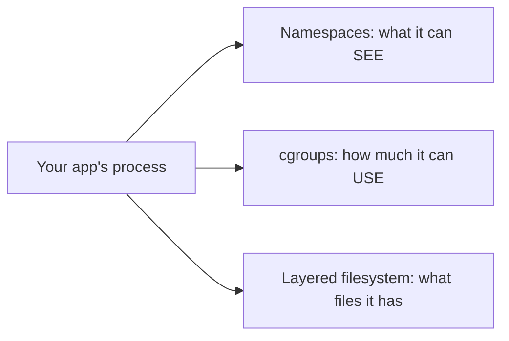
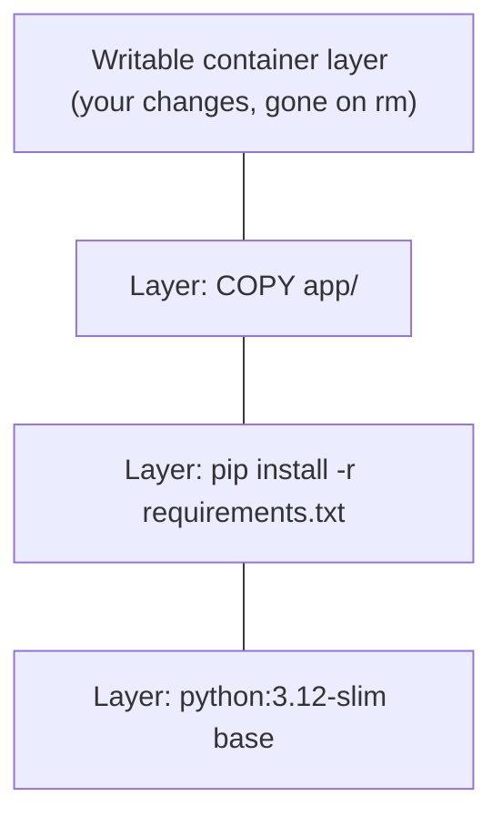

# Under the hood: namespaces, cgroups and layers

A container isn't a special kind of object in the Linux kernel. It's **an ordinary process** with three kernel features applied. (If you took Advanced Linux and System Internals, you built one by hand.)



## Namespaces: a private view

| Namespace | The process gets its own... |
|---|---|
| PID | Process list (it's PID 1 inside) |
| NET | Network interfaces, IP, ports, routes |
| MNT | Mount points (its own root filesystem) |
| UTS | Hostname |
| IPC | Shared memory |
| USER | User IDs (root inside can be nobody outside) |

## cgroups: limits

```bash
docker run -d --name app --memory 256m --cpus 0.5 nginx:1.27
docker stats app
```

Use more than 256 MB and the kernel kills the process (exit code **137**, OOM killed).

## Layers and the copy-on-write filesystem

An image is a stack of **read-only layers**; a running container adds one thin **writable layer** on top (overlayfs).



- Ten containers from the same image share the read-only layers: they cost disk once.
- Changing a file from a lower layer copies it up into the writable layer first.

## See it yourself

```bash
docker run -d --name s nginx:1.27
docker inspect --format '{{.State.Pid}}' s     # its PID on the host
sudo ls -l /proc/$(docker inspect --format '{{.State.Pid}}' s)/ns   # its namespaces
docker history nginx:1.27                       # its layers
```

Liz Rice's talk below builds a container in about 60 lines of Go, live. It makes all of this click.

## Optional videos

The lesson above is complete on its own. These go deeper, if you like learning by watching.

**Liz Rice, GOTO 2018: Containers from scratch**

https://www.youtube.com/watch?v=8fi7uSYlOdc
