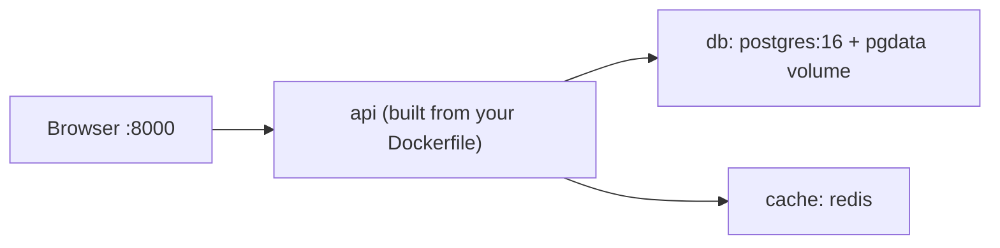

# Docker Compose: a whole app in one file

Typing `docker run` for every service gets old fast. **Compose** describes them all in `compose.yaml`:

```yaml
services:
  api:
    build: .
    ports: ["8000:8000"]
    environment:
      DATABASE_URL: postgresql://app:${DB_PASSWORD}@db:5432/app
      REDIS_URL: redis://cache:6379/0
    depends_on:
      db:
        condition: service_healthy
      cache:
        condition: service_started
    restart: unless-stopped

  db:
    image: postgres:16
    environment:
      POSTGRES_USER: app
      POSTGRES_PASSWORD: ${DB_PASSWORD}
      POSTGRES_DB: app
    volumes: ["pgdata:/var/lib/postgresql/data"]
    healthcheck:
      test: ["CMD-SHELL", "pg_isready -U app"]
      interval: 5s
      retries: 10

  cache:
    image: redis:7-alpine

volumes:
  pgdata:
```

```bash
echo "DB_PASSWORD=dev-only-password" > .env     # Compose reads .env for ${...}; keep it out of Git
docker compose up -d --build
docker compose ps
docker compose logs -f api
docker compose exec db psql -U app
docker compose down          # stop and remove containers and the network (volumes stay)
docker compose down -v       # ...and the volumes (deletes the data!)
```

## What Compose gives you

- One network for the project: services reach each other by **service name** (`db`, `cache`).
- `depends_on` with `condition: service_healthy` waits until the database actually accepts connections, not just until its container started.
- The whole stack starts, stops and rebuilds with one command, and the file lives in Git next to the code.



## Optional videos

The lesson above is complete on its own. These go deeper, if you like learning by watching.

**TechWorld with Nana: Docker tutorial for beginners, full course (see Docker Compose)**

https://www.youtube.com/watch?v=3c-iBn73dDE
