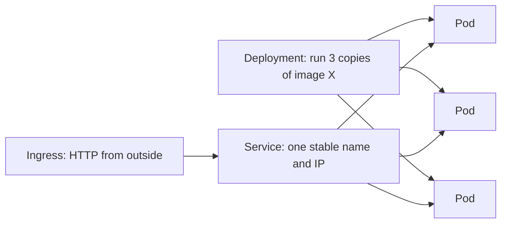

# Shipping images, and what comes after Docker

## Build once, deploy the same image everywhere

```bash
docker build -t ghcr.io/acme/shop-api:$(git rev-parse --short HEAD) .
docker push ghcr.io/acme/shop-api:$(git rev-parse --short HEAD)
```

Tag with the **commit**: every image traces back to exact code. Promote that same image from staging to production (DevOps and CI/CD course).

## Multi-architecture images

Laptops are often ARM (Apple Silicon), servers often x86, and ARM servers (AWS Graviton) are cheaper. **buildx** builds both:

```bash
docker buildx create --use
docker buildx build --platform linux/amd64,linux/arm64 -t ghcr.io/acme/shop-api:1.4.2 --push .
```

## In CI (GitHub Actions)

```yaml
- uses: docker/setup-buildx-action@v3
- uses: docker/login-action@v3
  with: {registry: ghcr.io, username: "${{ github.actor }}", password: "${{ secrets.GITHUB_TOKEN }}"}
- uses: docker/build-push-action@v6
  with:
    push: true
    tags: ghcr.io/${{ github.repository }}:${{ github.sha }}
    cache-from: type=gha
    cache-to: type=gha,mode=max
```

## Where containers run in production

| Option | When |
|---|---|
| One server with Compose | Small apps, side projects; simple and fine |
| **Managed containers** (AWS ECS/Fargate, Google Cloud Run, Azure Container Apps) | You want containers without managing servers |
| **Kubernetes** (EKS, GKE, AKS, k3s) | Many services, teams, autoscaling, self-healing at scale |

## Kubernetes in one picture



Kubernetes keeps the number of copies you asked for, replaces crashed ones, rolls out new versions gradually and spreads pods over machines. Everything you learned here (images, ports, volumes, health checks, env vars) carries straight over. The Docker and Kubernetes course in the library goes deeper into Kubernetes.
