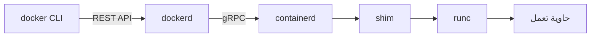

# معمارية Docker Engine

## من الأمر إلى الحاوية

- **dockerd**: الـ daemon، يستقبل أوامرك.
- **containerd**: يدير دورة حياة الحاويات.
- **runc**: يكلم الـ kernel وينشئ الحاوية ثم يخرج.
- **shim**: يبقى مع الحاوية، فيمكن إعادة تشغيل الـ daemon بدون إيقاف الحاويات.
