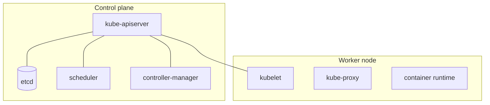

# مقدمة ومعمارية Kubernetes

## لماذا Kubernetes؟

منصة لتشغيل الحاويات على cluster: يجدولها، يعيدها إذا سقطت، يكبرها، يحدثها بلا توقف، ويوزع الطلبات عليها.

- **etcd**: مخزن حالة الـ cluster.
- **scheduler**: يختار الجهاز لكل Pod.
- **kubelet**: على كل جهاز، يتأكد أن الـ Pods المطلوبة تعمل.
