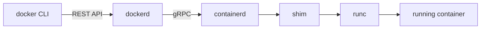

# Docker Engine architecture

- **dockerd**: the daemon that receives your commands.
- **containerd**: manages the container lifecycle.
- **runc**: talks to the kernel, creates the container, then exits.
- **shim**: stays with the container, so the daemon can restart without stopping containers.
