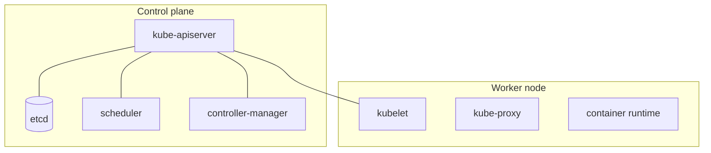

# Kubernetes intro and architecture

Kubernetes runs containers on a cluster: it schedules them, restarts them, scales them, updates them without
downtime and load-balances traffic.

- **etcd**: the cluster's state. **scheduler**: picks a node for each Pod. **kubelet**: makes sure a node's Pods run.
