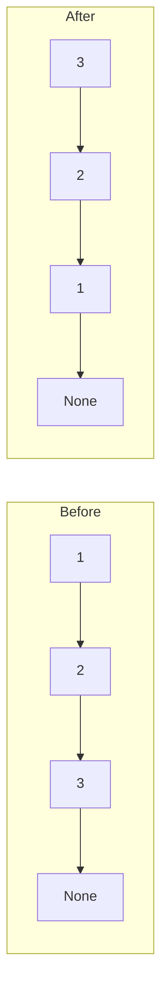

# Linked lists

A **linked list** is a chain of nodes, each pointing to the next. Unlike an array, there's no `a[i]`: reaching the 5th item means walking 5 steps. But inserting or removing a node you already hold is O(1).

```python
class ListNode:
    def __init__(self, val=0, next=None):
        self.val = val
        self.next = next
```

Interviews use linked lists to test **careful pointer handling**. Draw boxes and arrows on paper; it prevents most bugs.

## Reverse a list

```python
def reverse(head: ListNode | None) -> ListNode | None:
    prev = None
    cur = head
    while cur:
        nxt = cur.next      # remember the rest
        cur.next = prev     # turn the arrow around
        prev = cur
        cur = nxt
    return prev
```



Each step turns one arrow around: `prev` is the part already reversed, `cur` the node being turned, `nxt` the rest.

Four lines you should be able to write without thinking. O(n) time, O(1) space.

## The dummy node trick

When the head itself might change (removing it, merging lists), start with a fake node in front:

```python
def merge(a: ListNode | None, b: ListNode | None) -> ListNode | None:
    dummy = tail = ListNode()
    while a and b:
        if a.val <= b.val:
            tail.next, a = a, a.next
        else:
            tail.next, b = b, b.next
        tail = tail.next
    tail.next = a or b
    return dummy.next
```

No special case for "the first node".

## Fast and slow pointers

Move one pointer 1 step and another 2 steps:

- **Middle of the list**: when fast reaches the end, slow is in the middle.
- **Cycle detection** (Floyd's algorithm): if there's a loop, fast eventually laps slow.

```python
def has_cycle(head: ListNode | None) -> bool:
    slow = fast = head
    while fast and fast.next:
        slow = slow.next
        fast = fast.next.next
        if slow is fast:
            return True
    return False
```

O(1) space, where a set of visited nodes would need O(n).

### Remove the n-th node from the end, in one pass

Move a front pointer n steps ahead, then move both until the front hits the end. The back pointer is now just before the node to remove. Use a dummy node in case it's the head.

## Edge cases to always check

- Empty list (`head is None`)
- One node
- Two nodes
- The operation touches the head or the tail

## Practice

- Reverse Linked List (206)
- Merge Two Sorted Lists (21)
- Linked List Cycle (141)
- Middle of the Linked List (876)
- Remove Nth Node From End of List (19)
- Reorder List (143): find the middle, reverse the second half, merge

## Optional videos

The lesson above is complete on its own. These go deeper, if you like learning by watching.

**Reverse Linked List, iterative and recursive (NeetCode)**

https://www.youtube.com/watch?v=G0_I-ZF0S38
