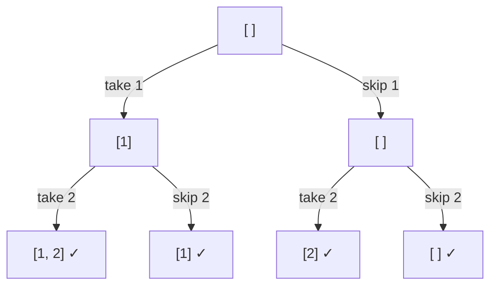

# Recursion and backtracking

A **recursive** function solves a problem by calling itself on a smaller version of it. Every recursive function needs:

1. A **base case** that stops it.
2. A **step** that moves toward the base case.

```python
def factorial(n: int) -> int:
    if n <= 1:          # base case
        return 1
    return n * factorial(n - 1)
```

Think of it with trust: assume the call on the smaller problem works, and only work out how to use its answer.

Python's default recursion limit is about 1000 calls deep. Very deep recursion (a 100,000-node list) needs a loop instead.

## Backtracking: try, go deeper, undo

Backtracking explores **all choices** by building a solution step by step and undoing each step after exploring it. It's the pattern for "all subsets", "all permutations", "all combinations", puzzles and grids.

### All subsets

```python
def subsets(nums: list[int]) -> list[list[int]]:
    out, cur = [], []
    def go(i: int):
        if i == len(nums):
            out.append(cur.copy())     # copy! cur keeps changing
            return
        cur.append(nums[i])            # choose: take nums[i]
        go(i + 1)
        cur.pop()                      # undo
        go(i + 1)                      # choose: skip nums[i]
    go(0)
    return out
```

2ⁿ subsets, each copied in O(n): O(n · 2ⁿ). Exponential is expected here: the output itself is that big.

The choices form a tree. For `nums = [1, 2]`:



Backtracking walks this tree depth first: go down a branch, record the leaf, come back up (undo), take the other branch.


### Combination sum (numbers may repeat)

```python
def combination_sum(cands: list[int], target: int) -> list[list[int]]:
    out, cur = [], []
    def go(start: int, left: int):
        if left == 0:
            out.append(cur.copy()); return
        for i in range(start, len(cands)):
            if cands[i] <= left:
                cur.append(cands[i])
                go(i, left - cands[i])   # i, not i + 1: may reuse
                cur.pop()
    cands.sort()
    go(0, target)
    return out
```

Passing `start` avoids the same combination in different orders.

## The template

```python
def backtrack(state):
    if is_complete(state):
        record(state); return
    for choice in choices(state):
        if is_valid(choice, state):
            make(choice, state)
            backtrack(state)
            undo(choice, state)
```

**Pruning** (skipping choices that can't work, like `cands[i] <= left`) is what makes backtracking fast enough in practice.

## Memoization preview

If a recursive function is called again with the **same arguments**, save the answers:

```python
from functools import cache

@cache
def fib(n: int) -> int:
    return n if n < 2 else fib(n - 1) + fib(n - 2)
```

Without `@cache`: O(2ⁿ). With it: O(n). That's the doorway to dynamic programming (Day 7).

## Practice

- Subsets (78)
- Permutations (46)
- Combination Sum (39)
- Word Search (79): backtracking on a grid
- Generate Parentheses (22)
