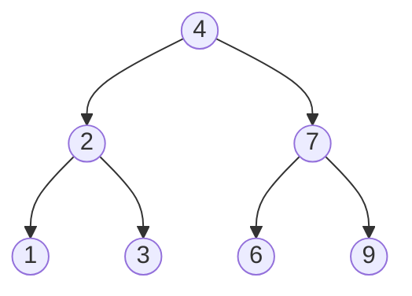

# Trees

A **binary tree** is made of nodes with up to two children. Trees appear everywhere: folders, the HTML page (the DOM), databases (B-trees), and lots of interview questions.

```python
class TreeNode:
    def __init__(self, val=0, left=None, right=None):
        self.val, self.left, self.right = val, left, right
```



Preorder: 4 2 1 3 7 6 9. Inorder: 1 2 3 4 6 7 9 (sorted, because this tree is a BST). Postorder: 1 3 2 6 9 7 4. Level order: [4], [2, 7], [1, 3, 6, 9].


## Think recursively

Most tree problems become simple when you ask: "if I knew the answer for the left and right subtrees, how would I get the answer for this node?"

```python
def max_depth(root: TreeNode | None) -> int:
    if not root:
        return 0
    return 1 + max(max_depth(root.left), max_depth(root.right))
```

```python
def invert(root: TreeNode | None) -> TreeNode | None:
    if root:
        root.left, root.right = invert(root.right), invert(root.left)
    return root
```

## Depth-first traversals (DFS)

| Order | Visit | Use |
|---|---|---|
| Preorder | node, left, right | copy a tree, serialize it |
| Inorder | left, node, right | a BST in sorted order |
| Postorder | left, right, node | delete a tree, compute sizes from children |

```python
def inorder(root, out):
    if root:
        inorder(root.left, out)
        out.append(root.val)
        inorder(root.right, out)
```

## Breadth-first: level by level (BFS)

```python
from collections import deque

def levels(root: TreeNode | None) -> list[list[int]]:
    if not root:
        return []
    out, q = [], deque([root])
    while q:
        level = []
        for _ in range(len(q)):          # exactly the nodes of this level
            node = q.popleft()
            level.append(node.val)
            if node.left: q.append(node.left)
            if node.right: q.append(node.right)
        out.append(level)
    return out
```

Use BFS for "level", "closest" or "minimum depth" questions.

## Passing information down vs up

- **Down** (as arguments): the path so far, allowed min/max values.
- **Up** (as return values): height, size, "is this subtree balanced?"

Diameter (longest path between any two nodes) uses both: return the height upward, update a best answer at each node:

```python
def diameter(root: TreeNode | None) -> int:
    best = 0
    def height(n):
        nonlocal best
        if not n:
            return 0
        l, r = height(n.left), height(n.right)
        best = max(best, l + r)          # path through this node
        return 1 + max(l, r)
    height(root)
    return best
```

## Complexity

Visiting every node once: **O(n) time**. Space: **O(h)** for the recursion, where h is the height: O(log n) for a balanced tree, O(n) for a tree shaped like a line.

## Practice

- Maximum Depth of Binary Tree (104)
- Invert Binary Tree (226)
- Same Tree (100)
- Binary Tree Level Order Traversal (102)
- Diameter of Binary Tree (543)
- Lowest Common Ancestor of a Binary Tree (236)

## Optional videos

The lesson above is complete on its own. These go deeper, if you like learning by watching.

**Invert Binary Tree (NeetCode)**

https://www.youtube.com/watch?v=OnSn2XEQ4MY

**Data Structures Easy to Advanced, full course (freeCodeCamp.org, William Fiset)**

https://www.youtube.com/watch?v=RBSGKlAvoiM
