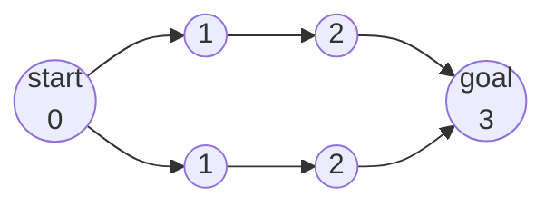

# Graphs

A **graph** is a set of nodes connected by edges: friends, roads, web links, course prerequisites, the cells of a grid. Trees are graphs without cycles.

## Representing a graph

The usual choice is an **adjacency list**:

```python
from collections import defaultdict

edges = [(0, 1), (0, 2), (1, 3)]
graph = defaultdict(list)
for a, b in edges:
    graph[a].append(b)
    graph[b].append(a)      # leave this out for a directed graph
```

A **grid** is a graph too: each cell's neighbours are up, down, left and right.

## Depth-first search (DFS)

Go as deep as possible, then back up. Use a `seen` set: unlike trees, graphs can have cycles.

```python
def count_islands(grid: list[list[str]]) -> int:
    rows, cols = len(grid), len(grid[0])
    seen = set()
    def dfs(r, c):
        if (r < 0 or c < 0 or r >= rows or c >= cols
                or grid[r][c] != "1" or (r, c) in seen):
            return
        seen.add((r, c))
        for dr, dc in ((1, 0), (-1, 0), (0, 1), (0, -1)):
            dfs(r + dr, c + dc)
    count = 0
    for r in range(rows):
        for c in range(cols):
            if grid[r][c] == "1" and (r, c) not in seen:
                dfs(r, c)
                count += 1
    return count
```

O(rows × cols): every cell is visited once.

## Breadth-first search (BFS): shortest paths

When every edge costs the same, BFS finds the **shortest path** in steps, because it explores in rings of distance 1, 2, 3...



Everything at distance 1 is visited before anything at distance 2, so the first time BFS reaches the goal, it's by a shortest path.


```python
from collections import deque

def shortest(graph, start, goal) -> int:
    q = deque([(start, 0)])
    seen = {start}
    while q:
        node, dist = q.popleft()
        if node == goal:
            return dist
        for nxt in graph[node]:
            if nxt not in seen:
                seen.add(nxt)            # mark when adding, not when popping
                q.append((nxt, dist + 1))
    return -1
```

**Multi-source BFS**: start with several nodes in the queue at once (for example "rotting oranges": every rotten orange spreads at the same time).

## Topological sort: order with prerequisites

"You must take course A before B." Is there a valid order? (Kahn's algorithm)

```python
def can_finish(n: int, prereqs: list[list[int]]) -> bool:
    graph = defaultdict(list)
    indeg = [0] * n
    for course, before in prereqs:
        graph[before].append(course)
        indeg[course] += 1
    q = deque(i for i in range(n) if indeg[i] == 0)
    taken = 0
    while q:
        c = q.popleft()
        taken += 1
        for nxt in graph[c]:
            indeg[nxt] -= 1
            if indeg[nxt] == 0:
                q.append(nxt)
    return taken == n          # if not, there's a cycle
```

## Beyond

- **Weighted shortest paths**: Dijkstra's algorithm (BFS with a heap), O(E log V).
- **Connected groups**: Union-Find (disjoint sets), nearly O(1) per operation.

## Complexity

DFS and BFS: **O(V + E)**, every node and edge once.

## Practice

- Number of Islands (200)
- Flood Fill (733)
- Rotting Oranges (994): multi-source BFS
- Clone Graph (133)
- Course Schedule (207)
- Network Delay Time (743): Dijkstra

## Optional videos

The lesson above is complete on its own. These go deeper, if you like learning by watching.

**Number of Islands (NeetCode)**

https://www.youtube.com/watch?v=pV2kpPD66nE

**Graph Algorithms for Technical Interviews (freeCodeCamp.org, Alvin Zablan)**

https://www.youtube.com/watch?v=tWVWeAqZ0WU
