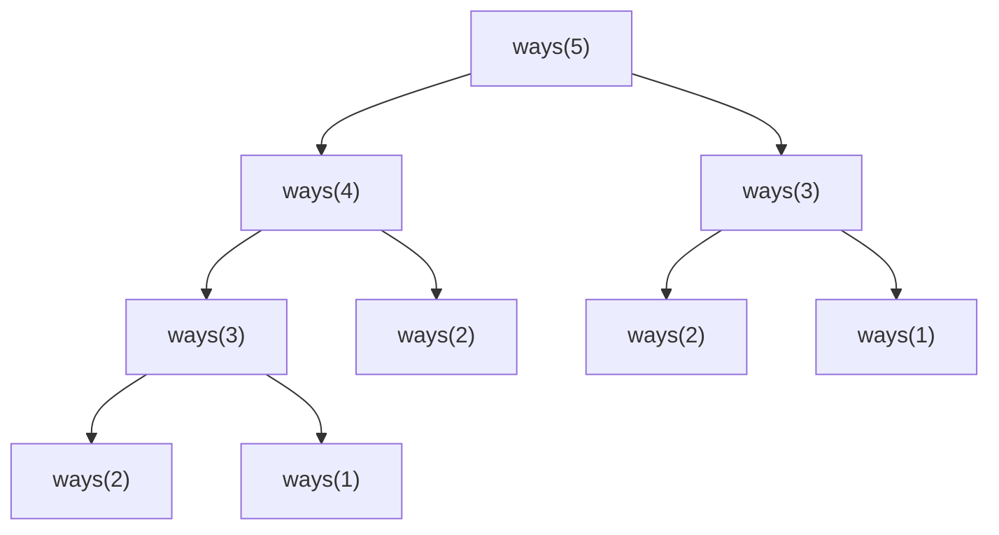

# Dynamic programming, part 1

**Dynamic programming (DP)** solves a problem by combining answers to **smaller versions of the same problem**, computing each smaller answer **only once**.

DP fits when:
1. The answer can be built from answers to sub-problems, and
2. The same sub-problems come up again and again.

## The four steps

1. **State**: what does `dp[i]` mean, in words? ("the number of ways to reach step i")
2. **Transition**: how is `dp[i]` built from smaller states?
3. **Base cases**: the smallest states, known directly.
4. **Answer**: which state holds the final answer?

Write step 1 as a sentence before any code. Most DP mistakes are an unclear state.

## Climbing stairs

You climb 1 or 2 steps at a time. How many ways to reach step n?

- State: `ways[i]` = ways to reach step i.
- Transition: the last move was 1 step (from i−1) or 2 steps (from i−2): `ways[i] = ways[i-1] + ways[i-2]`.
- Base: `ways[0] = 1`, `ways[1] = 1`.

Plain recursion recomputes the same steps again and again:



`ways(3)` is computed twice and `ways(2)` three times; for n = 50 it's billions of calls. DP computes each one **once**.


```python
def climb(n: int) -> int:
    a, b = 1, 1                 # ways[i-2], ways[i-1]
    for _ in range(n - 1):
        a, b = b, a + b
    return b
```

O(n) time, O(1) space, because each state needs only the previous two.

## Top-down or bottom-up

**Top-down**: write the recursion, add a cache.

```python
from functools import cache

def rob(houses: list[int]) -> int:
    @cache
    def best(i: int) -> int:            # most money from houses[i:]
        if i >= len(houses):
            return 0
        return max(best(i + 1), houses[i] + best(i + 2))   # skip it, or rob it and skip the next
    return best(0)
```

**Bottom-up**: fill a table from the base cases up.

```python
def rob_table(houses: list[int]) -> int:
    take, skip = 0, 0
    for h in houses:
        take, skip = skip + h, max(take, skip)
    return max(take, skip)
```

Top-down is easier to discover; bottom-up avoids deep recursion and often saves memory. In an interview, start with whichever you can explain.

## Coin change: fewest coins

```python
def coin_change(coins: list[int], amount: int) -> int:
    INF = float("inf")
    dp = [0] + [INF] * amount           # dp[x] = fewest coins to make x
    for x in range(1, amount + 1):
        for c in coins:
            if c <= x:
                dp[x] = min(dp[x], dp[x - c] + 1)
    return -1 if dp[amount] == INF else dp[amount]
```

O(amount × coins). Note that "always take the biggest coin" (greedy) fails for coins like [1, 3, 4] and amount 6; DP doesn't.

## Longest increasing subsequence (O(n²) version)

`dp[i]` = length of the longest increasing subsequence **ending at i**:

```python
def lis(nums: list[int]) -> int:
    dp = [1] * len(nums)
    for i in range(len(nums)):
        for j in range(i):
            if nums[j] < nums[i]:
                dp[i] = max(dp[i], dp[j] + 1)
    return max(dp, default=0)
```

## Practice

- Climbing Stairs (70)
- House Robber (198)
- Min Cost Climbing Stairs (746)
- Coin Change (322)
- Longest Increasing Subsequence (300)
- Word Break (139)

## Optional videos

The lesson above is complete on its own. These go deeper, if you like learning by watching.

**Climbing Stairs (NeetCode)**

https://www.youtube.com/watch?v=Y0lT9Fck7qI

**House Robber (NeetCode)**

https://www.youtube.com/watch?v=73r3KWiEvyk

**Dynamic Programming, full course (freeCodeCamp.org, Alvin Zablan)**

https://www.youtube.com/watch?v=oBt53YbR9Kk
