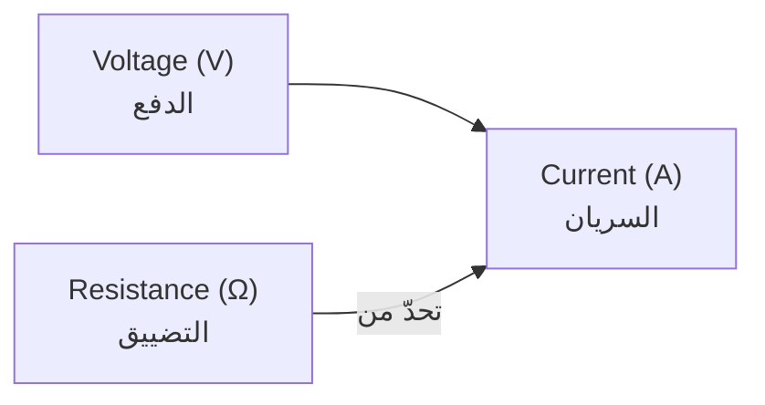

# الـ Voltage والـ Current والـ Resistance

كل جهاز إلكتروني، من الكشاف إلى الموبايل، يرجع في الآخر إلى ثلاث أفكار: **الـ voltage** و**الـ current** و**الـ resistance**. افهمها جيدًا وكل الإلكترونيات بعدها مبنية عليها.

هذا الكورس عملي. ستفهم الدوائر على الورق، ثم تبنيها على breadboard وتقيسها. لا شيء هنا يستخدم كهرباء البيت: كل شيء يعمل من بطاريات أو USB، بجهد 12 V أو أقل.

## الـ Current: السريان

الـ **current** سريان للشحنات (الإلكترونات) في موصل، مثل الماء في ماسورة. ويُقاس بالـ **ampere** ‏(A)، وغالبًا بالـ milliampere ‏(mA) في الدوائر الصغيرة: 1 A = 1000 mA.

- الـ LED يحتاج حوالي 10 إلى 20 mA.
- شاحن الموبايل يعطي من 1 إلى 3 A.

الـ current لا يسري إلا في **دائرة مغلقة**: من المصدر، عبر الأجزاء، ثم يرجع. افتح الدائرة في أي مكان (switch، أو سلك مقطوع) فيتوقف كل شيء.

## الـ Voltage: الدفع

الـ **voltage** هو "الضغط" الذي يدفع الـ current حول الدائرة، ويُقاس بالـ **volt** ‏(V). ويُقاس دائمًا **بين نقطتين**: البطارية بينها 1.5 V بين طرفيها + و−.

- بطارية AA: ‏1.5 V
- الـ USB: ‏5 V
- بطارية السيارة: 12 V

عادة نقيس الـ voltages بالنسبة لنقطة مشتركة واحدة اسمها **الـ ground** ‏(GND، ‏0 V)، وهي عادة طرف − في البطارية.

## الـ Resistance: التضييق

الـ **resistance** هي مقدار ممانعة الجزء للـ current، وتُقاس بالـ **ohm** ‏(Ω). resistance أكبر يعني current أقل لنفس الدفع. والـ **resistor** جزء مصنوع ليكون له resistance دقيقة، مثل 220 Ω أو 10 kΩ ‏(10,000 Ω).



## قراءة رسومات الدوائر

المهندسون يرسمون الدوائر كـ **schematics**: رموز بسيطة بدل صور الأجزاء الحقيقية. وهذه الرموز التي ستقابلها في الكورس، بجوار الشيء الحقيقي:


## أول دائرة لك

هذه نفس الدائرة البسيطة مرتين: أولًا كما ستبنيها، ثم كـ schematic. بطارية 9 V تدفع current عبر resistor، وmultimeter ‏(A) يقيس الـ current.


**كيف تقرأ هذه الصور:**

- السلك **الأحمر** هو طرف +؛ والسلك **الأزرق** هو طرف − الراجع إلى البطارية. (الأسلاك الحقيقية قد تكون بأي لون، لكن الأحمر للـ + والأسود أو الأزرق للـ − هي العادة.)
- **السهم البرتقالي** يبيّن الـ current: يخرج من + البطارية، ويمر عبر الـ resistor والـ meter، ويرجع إلى −. دائرة كاملة واحدة.
- في الـ schematic، البطارية هي الخطان على اليسار (الخط **الطويل** هو +)، والخط المتعرج هو الـ resistor، والدائرة المكتوب فيها **A** هي الـ meter.
- الخطوط أسلاك. طولها وشكلها لا يهمان، المهم فقط **ما المتصل بماذا**.

## الأدوات التي تحتاجها

| الأداة | لماذا |
|---|---|
| **Breadboard** | تركيب الأجزاء بدون لحام |
| **Jumper wires** | توصيل النقاط على الـ breadboard |
| **Multimeter** | قياس الـ voltage والـ current والـ resistance |
| **طقم resistors** ‏(من 10 Ω إلى 1 MΩ)، وLEDs، وبعض الـ capacitors، وpush buttons | أجزاء هذا الكورس |
| **بطارية 9 V مع clip**، أو موديول power لـ breadboard يعمل من USB ‏5 V | الكهرباء |

طقم أساسي فيه كل هذا تكلفته قليلة جدًا في محلات الإلكترونيات أو أونلاين.

### كيف يتوصل الـ breadboard من الداخل

```text
  a b c d e   f g h i j
1 o-o-o-o-o   o-o-o-o-o     كل صف من 5 (a-e) متصل ببعضه،
2 o-o-o-o-o   o-o-o-o-o     وكل صف من 5 (f-j) متصل ببعضه،
3 o-o-o-o-o   o-o-o-o-o     لكن النصفين غير متصلين ببعض.
          الفاصل
خط +: شريط طويل متصل على الجانب (للـ +)
خط -: شريط طويل متصل على الجانب (للـ GND)
```

الـ chips توضع فوق الفاصل في المنتصف لكي يأخذ كل pin صفًا خاصًا به.

## استخدام الـ multimeter

- **الـ voltage**: اضبط على V ‏(DC)، والـ probe الأحمر على النقطة، والأسود على الـ ground. الـ meter يوضع **على طرفي** الجزء.
- **الـ current**: اضبط على mA، وانقل السلك الأحمر إلى فتحة mA، وضع الـ meter **داخل الدائرة** (افتح الدائرة ودع الـ current يمر عبر الـ meter). لا تضع أبدًا meter مضبوطًا على current مباشرة على طرفي بطارية: هذا short circuit عبر الـ meter.
- **الـ resistance**: اضبط على Ω، وقِس الأجزاء **خارج الدائرة** (والكهرباء مفصولة).

## الأمان حتى مع الجهد المنخفض

- الـ **short circuit** ‏(+ متصل بـ − مباشرة بدون resistance) يجعل current ضخمًا يسري: الأسلاك والبطاريات تسخن، وبطاريات الليثيوم قد تشتعل. احرص دائمًا على وجود شيء يحدّ من الـ current في الدائرة.
- تأكد من الـ polarity ‏(+ و−) قبل توصيل الكهرباء.
- لا تعمل أبدًا على دوائر كهرباء البيت في هذا الكورس.

## الخلاصة

- الـ current ‏(A) يسري في دوائر مغلقة؛ والـ voltage ‏(V) يدفعه؛ والـ resistance ‏(Ω) تحدّ منه.
- الـ schematics ترسم الدوائر برموز؛ والـ ground هو مرجع الـ 0 V.
- breadboard وmultimeter وطقم أجزاء هي كل ما تحتاجه؛ قِس الـ voltage على الطرفين والـ current داخل الدائرة.

## فيديوهات اختيارية

الدرس أعلاه كامل وحده. هذه الفيديوهات للتعمق إن كنت تحب التعلم بالمشاهدة. الفيديوهات المكتوب بجانبها (بالإنجليزية) يمكنك تشغيل الترجمة لها (**CC**)، ثم **الإعدادات ← الترجمة ← ترجمة تلقائية ← العربية**.

**أساسيات الإلكترونيات 1: الجهد الكهربي (ابن تسلا)**

https://www.youtube.com/watch?v=9RsEh-X1ELQ

**أساسيات الإلكترونيات 3: المقاومة الكهربائية (ابن تسلا)**

https://www.youtube.com/watch?v=XYLUlkcX650

**Ohm's law explained: the basics of circuit theory (The Engineering Mindset) (بالإنجليزية)**

https://www.youtube.com/watch?v=HsLLq6Rm5tU
