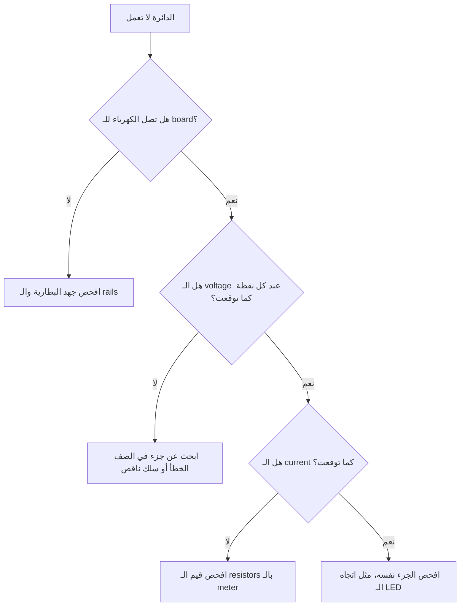

# التوصيل على التوالي والتوازي، والـ Voltage Divider

الدوائر الحقيقية تجمع عدة أجزاء. وطريقتان للتوصيل تغطيان كل شيء تقريبًا: **التوالي (series)** و**التوازي (parallel)**.

## الـ Series: مسار واحد

الأجزاء على التوالي تأتي واحدًا بعد الآخر، فيمر **نفس الـ current** في كلها. وقيم الـ resistance **تُجمع**.


**كيف تقرأها:** يوجد **مسار واحد فقط** حول الدائرة (السهم البرتقالي)، فيمر نفس الـ current في R1 وR2. والـ 12 V تُقسم بينهما: 4 V على R1 و8 V على R2.

```python
R1, R2, V = 100, 200, 12
R_total = R1 + R2
I = V / R_total
print(f"total {R_total} Ω, current {I * 1000:.0f} mA")
print(f"voltage across R1: {I * R1:.1f} V, across R2: {I * R2:.1f} V")
```

```output
total 300 Ω, current 40 mA
voltage across R1: 4.0 V, across R2: 8.0 V
```

جهد المصدر **يُقسم** بين الأجزاء، بنسبة الـ resistance: الـ resistor الأكبر يأخذ النصيب الأكبر. والأنصبة تُجمع دائمًا لتعطي جهد المصدر (4 + 8 = 12). وهذا هو **قانون كيرشوف للجهد (Kirchhoff's voltage law)**: حول أي دائرة، مجموع الـ voltages يساوي صفرًا.

## الـ Parallel: عدة مسارات

الأجزاء على التوازي متصلة **بنفس النقطتين**، فتأخذ كلها **نفس الـ voltage**. والـ current **ينقسم** بينها.


**كيف تقرأها:** الخط الأحمر في الأعلى متصل بأعلى **الاثنين**، والخط الأزرق يوصل أسفلهما. فكل resistor موضوع مباشرة على الـ 12 V، والـ current ينقسم إلى مسارين (السهمان البرتقاليان).

```python
R1, R2, V = 100, 300, 12
I1, I2 = V / R1, V / R2
R_total = 1 / (1 / R1 + 1 / R2)
print(f"I1 = {I1 * 1000:.0f} mA, I2 = {I2 * 1000:.0f} mA, total {(I1 + I2) * 1000:.0f} mA")
print(f"combined resistance {R_total:.0f} Ω")
```

```output
I1 = 120 mA, I2 = 40 mA, total 160 mA
combined resistance 75 Ω
```

- الـ currents تُجمع لتساوي الإجمالي الخارج من المصدر. وهذا **قانون كيرشوف للتيار (Kirchhoff's current law)**: ما يدخل نقطة يخرج منها.
- الـ resistance المجمعة **أصغر من أصغر** resistor: كل مسار جديد يسهّل سريان الـ current.
- للـ resistorين اختصار: R = (R1 × R2) / (R1 + R2).

مصابيح البيت متصلة على التوازي: كل واحد يأخذ الجهد كاملًا، وإطفاء أحدها لا يؤثر في الباقي.

## الـ Voltage Divider

resistorان على التوالي، مع أخذ المخرج من المنتصف، يعطيانك **جزءًا** من جهد الدخل:


**كيف تقرأها:** الـ 9 V تدخل من الأعلى (أحمر). والـ resistorان يتقاسمانها: R1 يأخذ 6 V وR2 يأخذ 3 V. والسلك الأخضر من **نقطة المنتصف** يعطيك هذه الـ 3 V. والأسفل يذهب إلى الـ ground ‏(أزرق).

**Vout = Vin × R2 / (R1 + R2)**

```python
def divider(vin, r1, r2):
    return vin * r2 / (r1 + r2)

print(divider(9, 10_000, 5_000))
print(round(divider(5, 10_000, 20_000), 2))
```

```output
3.0
3.33
```

الـ dividers في كل مكان:

- قراءة جهد بطارية بـ microcontroller لا يقبل أكثر من 3.3 V
- تحويل **sensor** تتغير الـ resistance الخاصة به (sensor ضوء، أو thermistor) إلى voltage متغير
- الـ **potentiometer** (المقبض) هو divider تحرّك نقطة منتصفه بيدك

ملاحظة: الـ divider يكون دقيقًا فقط عندما يسحب الشيء المتصل بـ Vout current صغيرًا جدًا. لا تستخدم divider لتشغيل أي شيء؛ استخدمه للقياس والإشارات.

## اكتشاف الأخطاء في دوائرك



احسب على الورق ما **يجب** أن يكون عليه كل voltage، ثم قِس نقطة بنقطة. وأول نقطة تختلف تبيّن لك مكان المشكلة.

## الخلاصة

- الـ Series: نفس الـ current، والـ resistances تُجمع، والـ voltage يُقسم بالنسبة.
- الـ Parallel: نفس الـ voltage، والـ currents تُجمع، والـ resistance المجمعة أقل من الأصغر.
- الـ Divider: ‏Vout = Vin × R2 / (R1 + R2)؛ جيد للقياس، لا للتشغيل.

## فيديوهات اختيارية

الدرس أعلاه كامل وحده. هذه الفيديوهات للتعمق إن كنت تحب التعلم بالمشاهدة. الفيديوهات المكتوب بجانبها (بالإنجليزية) يمكنك تشغيل الترجمة لها (**CC**)، ثم **الإعدادات ← الترجمة ← ترجمة تلقائية ← العربية**.

**Collin's Lab: Schematics (Make:) (بالإنجليزية)**

https://www.youtube.com/watch?v=9cps7Q_IrX0

**How to use a breadboard (Science Buddies) (بالإنجليزية)**

https://www.youtube.com/watch?v=6WReFkfrUIk
