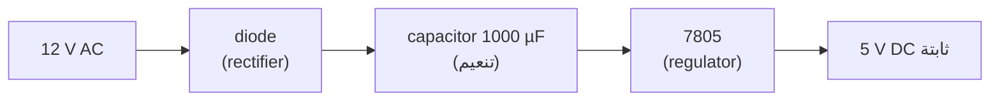

# مصادر الكهرباء (Power supplies): من AC إلى DC ثابت

أغلب الإلكترونيات تحتاج DC voltage ثابتًا، عادة 5 V أو 3.3 V. وهذا الدرس يبيّن كيف يصنعه الـ power supply، وكيف تختار واحدًا لمشاريعك.

## الـ AC والـ DC

- الـ **DC** ‏(direct current) يسري في اتجاه واحد بجهد ثابت: البطاريات، والـ USB.
- الـ **AC** ‏(alternating current) يعكس اتجاهه مرات كثيرة في الثانية: فيشة الحائط (في مصر 220 V عند 50 Hz). **لا تجرّب أبدًا على كهرباء البيت.** استخدم adapter جاهزًا يعطي جهدًا منخفضًا آمنًا.

## الـ linear supply الكلاسيكي

هذا ما بداخل power supply بسيط منخفض الجهد، يبدأ من 12 V AC ‏(من transformer خفّض جهد البيت بأمان بالفعل):


**كيف تقرأها، من اليسار لليمين:** الدائرة ذات الموجة هي دخل الـ 12 V AC. والـ diode ‏(المثلث) يمرر الـ current في اتجاه واحد فقط. والـ capacitor الكبير النازل إلى الـ ground ينعّم الارتفاعات. والصندوق المكتوب عليه 7805 هو الـ regulator: جهد متذبذب يدخل من اليسار (IN)، و5 V ثابتة تخرج من اليمين (OUT)، والـ pin الأوسط (GND) إلى الـ ground. والـ capacitor الصغير 100 nF على المخرج يحافظ على استقراره.



1. **الـ Rectifier**: الـ diode يمرر أنصاف الموجة الموجبة فقط من الـ AC. (الـ supplies الأفضل تستخدم **bridge** من أربعة diodes لتستفيد من النصفين.)
2. **التنعيم**: الـ capacitor الكبير يملأ الفراغات بين الارتفاعات، فيبقى DC voltage متذبذب قليلًا ("ripple").
3. **الـ Regulator**: الـ 7805 يحوّل هذا الجهد المتذبذب إلى 5 V ثابتة، طالما بقي دخله أعلى من 5 V بحوالي 2 V على الأقل.

## الـ Linear regulators وحرارتها

الـ **linear regulator** ‏(7805 وAMS1117 وLM1117) يعمل بحرق الجهد الزائد كحرارة:

**الحرارة = (Vin − Vout) × current**

```python
def regulator_heat(vin, vout, amps):
    return (vin - vout) * amps

for vin, amps in [(9, 0.1), (12, 0.5), (7, 0.5)]:
    w = regulator_heat(vin, 5, amps)
    advice = "fine without a heatsink" if w < 1 else "needs a heatsink or a switching regulator"
    print(f"{vin} V -> 5 V at {amps * 1000:.0f} mA: {w:.1f} W, {advice}")
```

```output
9 V -> 5 V at 100 mA: 0.4 W, fine without a heatsink
12 V -> 5 V at 500 mA: 3.5 W, needs a heatsink or a switching regulator
7 V -> 5 V at 500 mA: 1.0 W, needs a heatsink or a switching regulator
```

الكفاءة هي Vout / Vin: من 12 V إلى 5 V، أكثر من نصف الطاقة يصبح حرارة.

الـ regulators من نوع **LDO** ‏("low dropout") مثل AMS1117-3.3 تحتاج دخلًا أعلى من المخرج بحوالي 1 V فقط، فتستطيع صنع 3.3 V من 5 V الخاصة بالـ USB.

## الـ Switching regulators

الـ **switching regulator** ‏("buck" للخفض، و"boost" للرفع) يفتح ويغلق بسرعة كبيرة ويستخدم inductor وcapacitors لنقل الطاقة بكفاءة من 80 إلى 95%. والموديولات الجاهزة الرخيصة (مثل boards مبنية على MP1584 أو LM2596) هي الطريقة السهلة للحصول على 5 V من مصدر 12 V بدون حرارة. وهي تُحدث قليلًا من الضوضاء الكهربائية، وهذا مهم للقياسات الحساسة لكن نادرًا ما يهم في المشاريع الهواة.

## اختيار power supply لمشروع

| الموقف | اختيار جيد |
|---|---|
| مشروع 5 V صغير على المكتب | شاحن USB ‏(5 V، من 1 إلى 2 A) |
| chips ‏3.3 V من الـ USB | LDO ‏(AMS1117-3.3) |
| مصدر 12 V، وlogic بـ 5 V | buck module |
| يعمل بالبطارية، وعمر طويل | switching regulator، وأجزاء قليلة الاستهلاك |

وتحقق دائمًا من الـ **current**: اجمع ما يسحبه كل جزء، ثم اختر supply يعطي 1.5 مرة على الأقل من الإجمالي.

```python
parts_ma = {"microcontroller": 20, "LEDs (4 x 10 mA)": 40, "sensor": 5, "servo motor (peak)": 600}
total = sum(parts_ma.values())
print(f"total {total} mA -> choose a supply of at least {total * 1.5 / 1000:.1f} A")
```

```output
total 665 mA -> choose a supply of at least 1.0 A
```

## الخلاصة

- الـ Rectifier ثم capacitor التنعيم ثم الـ regulator: الـ AC يصبح DC ثابتًا؛ ولا تجرّب أبدًا على كهرباء البيت.
- الـ Linear regulators تحوّل الجهد الزائد إلى حرارة: ‏(Vin − Vout) × I؛ والـ LDOs تحتاج هامشًا أقل.
- الـ Switching regulators ‏(buck/boost) كفؤة؛ واختر الـ supply بـ 1.5 مرة من إجمالي الـ current.

## فيديوهات اختيارية

الدرس أعلاه كامل وحده. هذه الفيديوهات للتعمق إن كنت تحب التعلم بالمشاهدة. الفيديوهات المكتوب بجانبها (بالإنجليزية) يمكنك تشغيل الترجمة لها (**CC**)، ثم **الإعدادات ← الترجمة ← ترجمة تلقائية ← العربية**.

**Voltage regulator tutorial and USB charger circuit (Afrotechmods) (بالإنجليزية)**

https://www.youtube.com/watch?v=GSzVs7_aW-Y

**Diodes explained: how diodes work (The Engineering Mindset) (بالإنجليزية)**

https://www.youtube.com/watch?v=Fwj_d3uO5g8
