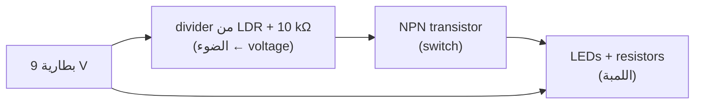

# مشروع: لمبة ليلية أوتوماتيكية

لنبنِ جهازًا صغيرًا كاملًا مما تعلمته: لمبة LED **تعمل وحدها عندما يحل الظلام**. تستخدم sensor ضوء في voltage divider، وtransistor switch، وLED مع الـ resistor الخاص به. بدون microcontroller.

## كيف تعمل




**كيف تقرأها:** على اليسار الـ divider الخاص بـ sensor الضوء: ‏100 kΩ من +9 V لأسفل إلى نقطة المنتصف الخضراء، ثم الـ LDR ‏(الـ resistor الذي عليه أسهم ضوء) لأسفل إلى الـ ground. ونقطة المنتصف تغذي base الـ transistor عبر 10 kΩ. وعلى اليمين ثلاثة LEDs، لكل منها resistor ‏330 Ω خاص به، معلقة من +9 V ‏(أحمر، في الأعلى) لأسفل إلى collector الـ transistor؛ والـ emitter الخاص به يذهب إلى الـ ground.

الـ LDR يوضع في **أسفل** الـ divider هذه المرة (الـ LDR من المنتصف إلى الـ ground، وresistor من 9 V إلى المنتصف):

- **ضوء ساطع**: الـ resistance الخاصة بالـ LDR منخفضة، فتكون نقطة المنتصف قريبة من 0 V. والـ base الخاص بالـ transistor يأخذ أقل من 0.7 V ← مطفأ ← اللمبة مطفأة.
- **ظلام**: الـ resistance الخاصة بالـ LDR ترتفع، وجهد المنتصف يرتفع فوق 0.7 V ← يعمل الـ transistor ← اللمبة تضيء.

## الأجزاء

| الجزء | القيمة |
|---|---|
| ‏LDR ‏(photoresistor) | مثلًا GL5528 (حوالي 10 kΩ في ضوء الغرفة، وأكثر من 1 MΩ في الظلام) |
| resistor الـ divider | ‏100 kΩ (أو potentiometer ‏100 kΩ لضبط الحد)؛ والدرس يبيّن لماذا ليس 47 kΩ |
| resistor الـ base | ‏10 kΩ |
| الـ Transistor | ‏2N2222 أو BC547 ‏(NPN) |
| الـ LEDs | ‏3 LEDs بيضاء، لكل منها resistor خاص |
| resistors الـ LEDs | ‏330 Ω لكل واحد |
| الكهرباء | بطارية 9 V مع clip، زائد capacitor ‏100 µF على طرفيها |

## تحقق من التصميم بالأرقام

قبل البناء، تحقق من الشرطين الأساسيين: الظلام يشغّلها، والضوء يبقيها مطفأة.

```python
def middle_voltage(v, r_top, r_ldr):
    return v * r_ldr / (r_top + r_ldr)

V, R_TOP = 9, 47_000
for light, r_ldr in [("bright room", 5_000), ("dusk", 15_000), ("dark", 200_000)]:
    vm = middle_voltage(V, R_TOP, r_ldr)
    state = "ON" if vm > 0.7 else "off"
    print(f"{light:11} LDR {r_ldr // 1000:>3} kΩ -> base side {vm:.2f} V -> lamp {state}")
```

```output
bright room LDR   5 kΩ -> base side 0.87 V -> lamp ON
dusk        LDR  15 kΩ -> base side 2.18 V -> lamp ON
dark        LDR 200 kΩ -> base side 7.29 V -> lamp ON
```

الأرقام تبيّن مشكلة قبل أن نبني أي شيء: مع 47 kΩ تضيء اللمبة حتى في غرفة مضيئة. الـ resistor العلوي صغير جدًا: الـ resistor العلوي الأكبر يسحب نقطة المنتصف لأسفل. نحتاج نقطة المنتصف **أقل** من 0.7 V في ضوء النهار. لنجد قيمة أفضل:

```python
# A bigger top resistor pulls the middle point down. Try a few values:
for r_top in [47_000, 100_000, 220_000]:
    bright = middle_voltage(V, r_top, 5_000)
    dusk = middle_voltage(V, r_top, 15_000)
    print(f"top {r_top // 1000:>3} kΩ: bright {bright:.2f} V, dusk {dusk:.2f} V")
```

```output
top  47 kΩ: bright 0.87 V, dusk 2.18 V
top 100 kΩ: bright 0.43 V, dusk 1.17 V
top 220 kΩ: bright 0.20 V, dusk 0.57 V
```

مع **100 kΩ** في الأعلى: مطفأة في غرفة مضيئة (0.43 V)، وتعمل عند الغروب (1.17 V). وهذا هو التصميم. (هذه تقديرات بسيطة: الـ base current يُحمّل الـ divider قليلًا، ولهذا الضبط مفيد.) والأفضل من ذلك، استخدم **potentiometer ‏100 kΩ** ‏(على التوالي مع 22 kΩ لكي لا يصل إلى الصفر أبدًا) وأدِره حتى تتحول اللمبة عند مستوى الضوء الذي تريده بالضبط.

هذه هي دائرة الهندسة الحقيقية: احسب، واكتشف المشكلة على الورق، واضبط، ثم ابنِ.

## الـ current في الـ LEDs

```python
v_led, r_led = 3.1, 220
i = (9 - 0.2 - v_led) / r_led          # about 0.2 V across the transistor when fully on
print(f"each LED: {i * 1000:.0f} mA, all three: {3 * i * 1000:.0f} mA through the transistor")
```

```output
each LED: 26 mA, all three: 78 mA through the transistor
```

‏26 mA في أعلى مدى الـ LED الأبيض المعتاد؛ استخدم 330 Ω ‏(حوالي 17 mA لكل واحد) لعمر أطول وبطارية تدوم أكثر. و78 mA مريحة للـ 2N2222، لكن الـ base يحتاج current كافيًا: في الظلام يعطي الـ divider الكثير.

## ابنِ واختبر

1. ضع الأجزاء على الـ breadboard حسب الرسم، والكهرباء **مفصولة**.
2. تحقق من اتجاه كل LED ومن أرجل الـ transistor ‏(E وB وC) مقابل الـ datasheet الخاص به؛ فترتيب الـ pins يختلف بين موديلات الـ transistors.
3. وصّل البطارية. غطِّ الـ LDR بيدك: تضيء الـ LEDs.
4. قِس جهد الـ base في الضوء والظلام، وقارنه بتوقعاتك.
5. اضبط الـ potentiometer لتحديد نقطة التحول.

لو لم تعمل، استخدم خطوات اكتشاف الأخطاء من الوحدة 2: الكهرباء أولًا، ثم الجهد عند كل نقطة مقارنة بما حسبته.

## دورك

1. أضف 555 لكي **تومض** اللمبة الليلية ببطء في الظلام (غذِّ الـ reset pin للـ 555 من الـ divider عبر الـ transistor).
2. بدّل الـ LDR والـ resistor العلوي: الآن تعمل اللمبة في الضوء **الساطع**. فيم قد يُستخدم ذلك؟
3. استبدل الـ LDR بـ thermistor واصنع لمبة تحذير "حار جدًا".
4. ارسم دائرتك النهائية كـ schematic ‏(على الورق، أو في KiCad في الكورس القادم).

## إلى أين بعد ذلك

التالي في مسار الإلكترونيات: **تصميم الـ PCB بـ KiCad**، حيث تحوّل دوائر الـ breadboard مثل هذه إلى circuit boards حقيقية مصنّعة.

## الخلاصة

- divider من sensor + transistor switch + مشغّل LED يصنع جهازًا أوتوماتيكيًا كاملًا.
- احسب قبل البناء: هنا اكتشفت الأرقام قيمة resistor خطأ قبل أي لحام.
- استخدم potentiometer لضبط الحدود، وقِس لتقارن الواقع بالتصميم.

## فيديوهات اختيارية

الدرس أعلاه كامل وحده. هذه الفيديوهات للتعمق إن كنت تحب التعلم بالمشاهدة. الفيديوهات المكتوب بجانبها (بالإنجليزية) يمكنك تشغيل الترجمة لها (**CC**)، ثم **الإعدادات ← الترجمة ← ترجمة تلقائية ← العربية**.

**أساسيات الإلكترونيات 32: فحص العناصر الإلكترونية (ابن تسلا)**

https://www.youtube.com/watch?v=zTVIkKSeOwI

**Astable 555 timer (Ben Eater) (بالإنجليزية)**

https://www.youtube.com/watch?v=kRlSFm519Bo
