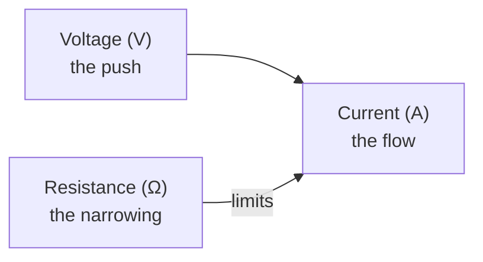

# Voltage, current and resistance

Every electronic device, from a torch to a phone, comes down to three ideas: **voltage**, **current** and **resistance**. Get these right and the rest of electronics builds on them.

This course is hands-on. You'll understand circuits on paper, then build them on a breadboard and measure them. Nothing here uses mains electricity: everything runs from batteries or USB, at 12 V or less.

## Current: the flow

Electric **current** is a flow of charge (electrons) through a conductor, like water through a pipe. It's measured in **amperes** (A), usually milliamperes (mA) in small circuits: 1 A = 1000 mA.

- An LED needs about 10 to 20 mA.
- A phone charger delivers 1 to 3 A.

Current only flows in a **closed loop**: from the source, through the parts, and back. Open the loop anywhere (a switch, a broken wire) and everything stops.

## Voltage: the push

**Voltage** is the "pressure" that pushes current around the loop, measured in **volts** (V). It's always measured **between two points**: a battery has 1.5 V between its + and − ends.

- AA battery: 1.5 V
- USB: 5 V
- Car battery: 12 V

We usually measure voltages relative to one shared point called **ground** (GND, 0 V), normally the battery's − side.

## Resistance: the narrowing

**Resistance** is how much a part opposes current, measured in **ohms** (Ω). More resistance means less current for the same push. A **resistor** is a part made to have a precise resistance, like 220 Ω or 10 kΩ (10,000 Ω).



## Reading circuit drawings

Engineers draw circuits as **schematics**: simple symbols instead of pictures of the real parts. Here are the symbols you'll meet in this course, next to the real thing:


## Your first circuit

Here is the same simple circuit twice: first as you'd build it, then as a schematic. A 9 V battery pushes current through a resistor, and a multimeter (A) measures the current.


**How to read these pictures:**

- The **red** wire is the + side; the **blue** wire is the − side going back to the battery. (Real wires can be any colour, but red for + and black or blue for − is the usual habit.)
- The **orange arrow** shows the current: it leaves the battery's +, goes through the resistor and the meter, and comes back to −. One complete loop.
- In the schematic, the battery is the pair of lines on the left (the **long** line is +), the zigzag is the resistor, and the circle with **A** is the meter.
- Lines are wires. Their exact length and shape don't matter, only **what connects to what**.

## The tools you need

| Tool | Why |
|---|---|
| **Breadboard** | plug parts in without soldering |
| **Jumper wires** | connect points on the breadboard |
| **Multimeter** | measure voltage, current and resistance |
| **Resistor kit** (10 Ω to 1 MΩ), LEDs, a few capacitors, push buttons | the parts for this course |
| **9 V battery with clip**, or a 5 V USB breadboard power module | the power |

A basic kit with all of this costs very little at electronics shops or online.

### How a breadboard is wired

```text
  a b c d e   f g h i j
1 o-o-o-o-o   o-o-o-o-o     each row of 5 (a-e) is connected,
2 o-o-o-o-o   o-o-o-o-o     and each row of 5 (f-j) is connected,
3 o-o-o-o-o   o-o-o-o-o     but the two halves are NOT connected.
          gap
+ rail: one long connected strip down the side (for +)
- rail: one long connected strip down the side (for GND)
```

Chips sit across the middle gap so each pin gets its own row.

## Using a multimeter

- **Voltage**: dial to V (DC), red probe to the point, black probe to ground. The meter goes **across** the part.
- **Current**: dial to mA, move the red lead to the mA socket, and put the meter **in the loop** (break the circuit and let the current flow through the meter). Never put a meter set to current straight across a battery: that's a short circuit through the meter.
- **Resistance**: dial to Ω, and measure parts **out of the circuit** (power off).

## Safety, even at low voltage

- A **short circuit** (+ connected straight to − with no resistance) makes huge current flow: wires and batteries get hot, and lithium batteries can catch fire. Always have something that limits current in the loop.
- Check polarity (+ and −) before connecting power.
- Never work on mains (wall socket) circuits in this course.

## Summary

- Current (A) flows in closed loops; voltage (V) pushes it; resistance (Ω) limits it.
- Schematics show circuits with symbols; ground is the 0 V reference.
- A breadboard, multimeter and parts kit are all you need; measure voltage across, current in the loop.

## Optional videos

The lesson above is complete on its own. These videos go deeper, if you like learning by watching.

**Ohm's law explained: the basics of circuit theory (The Engineering Mindset)**

https://www.youtube.com/watch?v=HsLLq6Rm5tU
