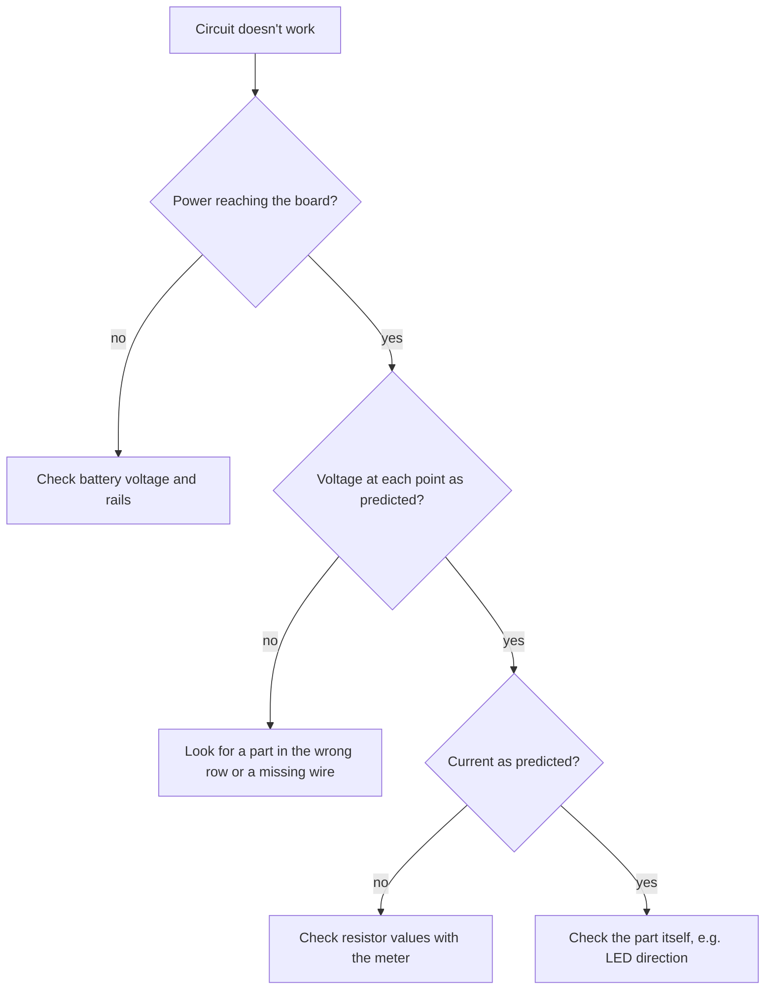

# Series, parallel and the voltage divider

Real circuits combine several parts. Two arrangements cover almost everything: **series** and **parallel**.

## Series: one path

Parts in series sit one after another, so the **same current** flows through all of them. Their resistances **add up**.


**How to read it:** there's only **one path** around the loop (orange arrow), so the same current goes through R1 and R2. The 12 V is shared: 4 V across R1 and 8 V across R2.

```python
R1, R2, V = 100, 200, 12
R_total = R1 + R2
I = V / R_total
print(f"total {R_total} Ω, current {I * 1000:.0f} mA")
print(f"voltage across R1: {I * R1:.1f} V, across R2: {I * R2:.1f} V")
```

```output
total 300 Ω, current 40 mA
voltage across R1: 4.0 V, across R2: 8.0 V
```

The supply voltage is **shared** between the parts, in proportion to their resistance: the bigger resistor gets the bigger share. The shares always add back up to the supply (4 + 8 = 12). This is **Kirchhoff's voltage law**: around any loop, the voltages add up to zero.

## Parallel: several paths

Parts in parallel connect across the **same two points**, so they all get the **same voltage**. The current **splits** between them.


**How to read it:** the red line on top connects to the top of **both** resistors, and the blue line connects both bottoms. So each resistor sits directly across the 12 V, and the current splits into two paths (the two orange arrows).

```python
R1, R2, V = 100, 300, 12
I1, I2 = V / R1, V / R2
R_total = 1 / (1 / R1 + 1 / R2)
print(f"I1 = {I1 * 1000:.0f} mA, I2 = {I2 * 1000:.0f} mA, total {(I1 + I2) * 1000:.0f} mA")
print(f"combined resistance {R_total:.0f} Ω")
```

```output
I1 = 120 mA, I2 = 40 mA, total 160 mA
combined resistance 75 Ω
```

- The currents add up to the total leaving the supply. This is **Kirchhoff's current law**: what flows into a point flows out.
- The combined resistance is **smaller than the smallest** resistor: each new path makes it easier for current to flow.
- For two resistors there's a shortcut: R = (R1 × R2) / (R1 + R2).

The lights in your home are in parallel: each gets the full voltage, and switching one off doesn't affect the others.

## The voltage divider

Two resistors in series, with an output taken from the middle, give you a **fraction** of the input voltage:


**How to read it:** 9 V enters at the top (red). The two resistors share it: R1 takes 6 V and R2 takes 3 V. The green wire from the **middle point** gives you that 3 V. The bottom goes to ground (blue).

**Vout = Vin × R2 / (R1 + R2)**

```python
def divider(vin, r1, r2):
    return vin * r2 / (r1 + r2)

print(divider(9, 10_000, 5_000))
print(round(divider(5, 10_000, 20_000), 2))
```

```output
3.0
3.33
```

Dividers are everywhere:

- reading a battery's voltage with a microcontroller that only accepts up to 3.3 V
- turning a **sensor** whose resistance changes (a light sensor, a thermistor) into a changing voltage
- a **potentiometer** (a knob) is a divider whose middle point you move

One catch: a divider is only accurate when the thing connected to Vout draws very little current. Don't use a divider to power anything; use it for measuring and signalling.

## Finding mistakes in your own circuits



Work out on paper what each voltage **should** be, then measure point by point. The first point that disagrees shows you where the problem is.

## Summary

- Series: same current, resistances add, voltage is shared in proportion.
- Parallel: same voltage, currents add, combined resistance is below the smallest.
- Divider: Vout = Vin × R2 / (R1 + R2); good for measuring, not for powering.

## Optional videos

The lesson above is complete on its own. These videos go deeper, if you like learning by watching.

**Collin's Lab: Schematics (Make:)**

https://www.youtube.com/watch?v=9cps7Q_IrX0

**How to use a breadboard (Science Buddies)**

https://www.youtube.com/watch?v=6WReFkfrUIk
