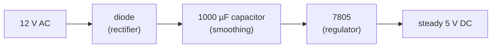

# Power supplies: from AC to steady DC

Most electronics need a steady DC voltage, usually 5 V or 3.3 V. This lesson shows how a supply produces it, and how to choose a supply for your own projects.

## AC and DC

- **DC** (direct current) flows one way at a steady voltage: batteries, USB.
- **AC** (alternating current) reverses direction many times a second: the wall socket (in Egypt 220 V at 50 Hz). **Never experiment with mains.** Use a ready-made adapter that gives safe low voltage.

## The classic linear supply

Here's what's inside a simple low-voltage supply, starting from 12 V AC (from a transformer that has already lowered the mains voltage safely):


**How to read it, left to right:** the wavy circle is the 12 V AC input. The diode (triangle) only lets current go one way. The big capacitor going down to ground smooths the bumps. The box marked 7805 is the regulator: wobbly voltage in on the left (IN), steady 5 V out on the right (OUT), and its middle pin (GND) to ground. The small 100 nF capacitor on the output keeps it stable.



1. **Rectifier**: the diode passes only the positive halves of the AC wave. (Better supplies use a **bridge** of four diodes to use both halves.)
2. **Smoothing**: the big capacitor fills the gaps between the bumps, leaving a wobbly DC voltage ("ripple").
3. **Regulator**: the 7805 turns that wobbly voltage into a steady 5 V, as long as its input stays at least about 2 V above 5 V.

## Linear regulators and their heat

A **linear regulator** (7805, AMS1117, LM1117) works by burning off the extra voltage as heat:

**heat = (Vin − Vout) × current**

```python
def regulator_heat(vin, vout, amps):
    return (vin - vout) * amps

for vin, amps in [(9, 0.1), (12, 0.5), (7, 0.5)]:
    w = regulator_heat(vin, 5, amps)
    advice = "fine without a heatsink" if w < 1 else "needs a heatsink or a switching regulator"
    print(f"{vin} V -> 5 V at {amps * 1000:.0f} mA: {w:.1f} W, {advice}")
```

```output
9 V -> 5 V at 100 mA: 0.4 W, fine without a heatsink
12 V -> 5 V at 500 mA: 3.5 W, needs a heatsink or a switching regulator
7 V -> 5 V at 500 mA: 1.0 W, needs a heatsink or a switching regulator
```

Efficiency is Vout / Vin: from 12 V to 5 V, more than half the energy becomes heat.

**LDO** ("low dropout") regulators like the AMS1117-3.3 only need their input about 1 V above the output, so they can make 3.3 V from 5 V USB.

## Switching regulators

A **switching regulator** ("buck" to step down, "boost" to step up) switches on and off very fast and uses an inductor and capacitors to transfer energy with 80 to 95% efficiency. Cheap ready-made modules (like boards based on the MP1584 or LM2596) are the easy way to get 5 V from a 12 V source without heat. They produce a little electrical noise, which matters for sensitive measurements but rarely for hobby projects.

## Choosing a supply for a project

| Situation | Good choice |
|---|---|
| Small 5 V project on a desk | a USB charger (5 V, 1 to 2 A) |
| 3.3 V chips from USB | an LDO (AMS1117-3.3) |
| 12 V supply, 5 V logic | a buck module |
| Battery powered, long life | a switching regulator, low-power parts |

And always check the **current**: add up what every part draws, then pick a supply that gives at least 1.5 times that.

```python
parts_ma = {"microcontroller": 20, "LEDs (4 x 10 mA)": 40, "sensor": 5, "servo motor (peak)": 600}
total = sum(parts_ma.values())
print(f"total {total} mA -> choose a supply of at least {total * 1.5 / 1000:.1f} A")
```

```output
total 665 mA -> choose a supply of at least 1.0 A
```

## Summary

- Rectifier, smoothing capacitor, regulator: AC becomes steady DC; never experiment with mains.
- Linear regulators turn extra voltage into heat: (Vin − Vout) × I; LDOs need less headroom.
- Switching (buck/boost) regulators are efficient; size the supply at 1.5× the total current.

## Optional videos

The lesson above is complete on its own. These videos go deeper, if you like learning by watching.

**Voltage regulator tutorial and USB charger circuit (Afrotechmods)**

https://www.youtube.com/watch?v=GSzVs7_aW-Y

**Diodes explained: how diodes work (The Engineering Mindset)**

https://www.youtube.com/watch?v=Fwj_d3uO5g8
