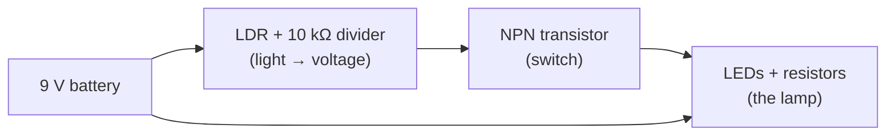

# Project: an automatic night light

Let's build a complete small device from what you've learned: an LED lamp that **turns on by itself when it gets dark**. It uses a light sensor in a voltage divider, a transistor switch and an LED with its resistor. No microcontroller needed.

## How it works




**How to read it:** on the left is the light sensor divider: 100 kΩ from +9 V down to the green middle point, then the LDR (the resistor with light arrows) down to ground. The middle point feeds the transistor's base through 10 kΩ. On the right, three LEDs, each with its own 330 Ω resistor, hang from +9 V (red, top) down to the transistor's collector; its emitter goes to ground.

The LDR goes at the **bottom** of the divider this time (LDR from the middle to ground, a resistor from 9 V to the middle):

- **Bright**: the LDR's resistance is low, so the middle point is close to 0 V. The transistor's base gets less than 0.7 V → off → lamp off.
- **Dark**: the LDR's resistance rises, the middle voltage rises above 0.7 V → the transistor turns on → lamp on.

## Parts

| Part | Value |
|---|---|
| LDR (photoresistor) | e.g. GL5528 (about 10 kΩ in room light, over 1 MΩ in the dark) |
| Divider resistor | 100 kΩ (or a 100 kΩ potentiometer to adjust the threshold); the lesson shows why not 47 kΩ |
| Base resistor | 10 kΩ |
| Transistor | 2N2222 or BC547 (NPN) |
| LEDs | 3 white LEDs, each with its own resistor |
| LED resistors | 330 Ω each |
| Power | 9 V battery with clip, plus a 100 µF capacitor across it |

## Check the design with numbers

Before building, check the two key conditions: dark turns it on, bright keeps it off.

```python
def middle_voltage(v, r_top, r_ldr):
    return v * r_ldr / (r_top + r_ldr)

V, R_TOP = 9, 47_000
for light, r_ldr in [("bright room", 5_000), ("dusk", 15_000), ("dark", 200_000)]:
    vm = middle_voltage(V, R_TOP, r_ldr)
    state = "ON" if vm > 0.7 else "off"
    print(f"{light:11} LDR {r_ldr // 1000:>3} kΩ -> base side {vm:.2f} V -> lamp {state}")
```

```output
bright room LDR   5 kΩ -> base side 0.87 V -> lamp ON
dusk        LDR  15 kΩ -> base side 2.18 V -> lamp ON
dark        LDR 200 kΩ -> base side 7.29 V -> lamp ON
```

The numbers show a problem before we build anything: with 47 kΩ the lamp is on even in a bright room. The top resistor is too small: a bigger top resistor pulls the middle point down. We need the middle point **below** 0.7 V in daylight. Let's find a better value:

```python
# A bigger top resistor pulls the middle point down. Try a few values:
for r_top in [47_000, 100_000, 220_000]:
    bright = middle_voltage(V, r_top, 5_000)
    dusk = middle_voltage(V, r_top, 15_000)
    print(f"top {r_top // 1000:>3} kΩ: bright {bright:.2f} V, dusk {dusk:.2f} V")
```

```output
top  47 kΩ: bright 0.87 V, dusk 2.18 V
top 100 kΩ: bright 0.43 V, dusk 1.17 V
top 220 kΩ: bright 0.20 V, dusk 0.57 V
```

With **100 kΩ** on top: off in a bright room (0.43 V), on at dusk (1.17 V). That's the design. (These are simple estimates: the base current loads the divider a little, which is why tuning is useful.) Better still, use a **100 kΩ potentiometer** (in series with 22 kΩ so it can never reach zero) and turn it until the lamp switches at exactly the light level you want.

This is the real engineering loop: calculate, find the problem on paper, adjust, then build.

## LED current

```python
v_led, r_led = 3.1, 220
i = (9 - 0.2 - v_led) / r_led          # about 0.2 V across the transistor when fully on
print(f"each LED: {i * 1000:.0f} mA, all three: {3 * i * 1000:.0f} mA through the transistor")
```

```output
each LED: 26 mA, all three: 78 mA through the transistor
```

26 mA is at the top of a typical white LED's range; use 330 Ω (about 17 mA each) for longer life and a longer-lasting battery. And 78 mA is comfortable for a 2N2222, but the base needs enough current: in the dark, the divider gives plenty.

## Build and test

1. Place the parts on the breadboard following the diagram, power **off**.
2. Check each LED's direction and the transistor's legs (E, B, C) against its datasheet; the pin order differs between transistor models.
3. Connect the battery. Cover the LDR with your hand: the LEDs light.
4. Measure the base voltage in light and dark, and compare with your predictions.
5. Adjust the potentiometer to set the switching point.

If it doesn't work, use the debugging flow from module 2: power first, then the voltage at each point compared with what you calculated.

## Your turn

1. Add a 555 so the night light **blinks** slowly in the dark (feed the 555's reset pin from the divider through the transistor).
2. Swap the LDR and the top resistor: now the lamp turns on in **bright** light. What could that be used for?
3. Replace the LDR with a thermistor and make a "too hot" warning light.
4. Draw your final circuit as a schematic (on paper, or in KiCad in the next course).

## Where to go next

Next in the electronics path: **PCB design with KiCad**, where you turn breadboard circuits like this into real, manufactured circuit boards.

## Summary

- A sensor divider + transistor switch + LED driver makes a complete automatic device.
- Calculate before building: here the numbers caught a wrong resistor value before any soldering.
- Use a potentiometer to tune thresholds, and measure to compare reality with the design.

## Optional videos

The lesson above is complete on its own. These videos go deeper, if you like learning by watching.

**Astable 555 timer (Ben Eater)**

https://www.youtube.com/watch?v=kRlSFm519Bo
