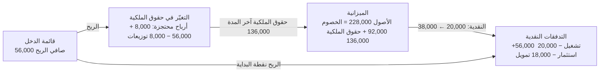

# القوائم الأربع وكيف تترابط

في الكورس الأول بنيت قائمة دخل وميزانية صغيرتين لمخبز نور. الشركات الحقيقية تنشر **أربع** قوائم، وتتعشّق معًا مثل التروس.

| القائمة | السؤال الذي تجيب عنه | تغطي |
|---|---|---|
| **قائمة الدخل** (قائمة الأرباح أو الخسائر) | هل حققنا ربحًا؟ | فترة |
| **الميزانية** (قائمة المركز المالي) | ماذا نملك وماذا علينا؟ | يومًا واحدًا |
| **قائمة التغيّر في حقوق الملكية** | لماذا تغيّر نصيب الملاك؟ | فترة |
| **قائمة التدفقات النقدية** | من أين جاءت النقدية وأين ذهبت؟ | فترة |

ومعها **الإيضاحات المتممة**: صفحات من التفاصيل والسياسات المحاسبية، وهي جزء من القوائم. المحللون كثيرًا ما يقرؤون الإيضاحات أولًا.

## كيف تترابط

- **صافي الربح** من قائمة الدخل يدخل **الأرباح المحتجزة** في قائمة التغيّر في حقوق الملكية.
- **حقوق الملكية آخر المدة** تظهر في الميزانية.
- **التغيّر في النقدية** في الميزانية تشرحه قائمة التدفقات النقدية بندًا بندًا.

## شركتنا في هذا الكورس

سنستخدم شركة واحدة طوال الكورس: **شركة الوادي الأخضر للتجارة**، محل يشتري أدوات منزلية من تجّار الجملة ويبيعها للزبائن. هذه أرقام 2025 باختصار. كل درس قادم يفتح واحدًا منها.

**قائمة الدخل عن السنة المنتهية في 31 ديسمبر 2025 (بالجنيه)**

| | |
|---|---|
| صافي المبيعات | 490,000 |
| تكلفة البضاعة المباعة | (294,000) |
| **مجمل الربح** | **196,000** |
| المصروفات التشغيلية | (122,000) |
| **ربح التشغيل** | **74,000** |
| مصروف الفوائد | (4,000) |
| الربح قبل الضريبة | 70,000 |
| ضريبة الدخل (20%) | (14,000) |
| **صافي الربح** | **56,000** |

**الميزانية في 31 ديسمبر**

| | 2025 | 2024 |
|---|---|---|
| النقدية | 38,000 | 20,000 |
| العملاء (بالصافي) | 45,000 | 38,000 |
| المخزون | 60,000 | 52,000 |
| مصروفات مدفوعة مقدمًا | 5,000 | 4,000 |
| المعدات (بالصافي) | 80,000 | 70,000 |
| **إجمالي الأصول** | **228,000** | **184,000** |
| الخصوم المتداولة | 52,000 | 46,000 |
| قرض طويل الأجل | 40,000 | 50,000 |
| رأس المال المدفوع | 80,000 | 80,000 |
| الأرباح المحتجزة | 56,000 | 8,000 |
| **إجمالي الخصوم وحقوق الملكية** | **228,000** | **184,000** |

لاحظ: الوادي الأخضر ربحت **56,000** لكن نقديتها زادت **18,000** فقط. أين ذهب الباقي؟ بحلول اليوم السابع ستقدر تجيب بالضبط.

## الشركات والمالك الفرد

الوادي الأخضر **شركة**، فتتغيّر بعض الأسماء عن الكورس الأول:

| المالك الفرد (نور) | الشركة (الوادي الأخضر) |
|---|---|
| رأس المال | رأس المال المدفوع (الأسهم) |
| الربح يُضاف لرأس المال | الربح يُضاف إلى **الأرباح المحتجزة** |
| المسحوبات | **توزيعات الأرباح** |
| قائمة حقوق المالك | قائمة التغيّر في حقوق الملكية |

## المعايير: IFRS والمعايير المصرية وGAAP

معظم الدول تستخدم **IFRS** (المعايير الدولية للتقارير المالية)، ومصر لها **معايير المحاسبة المصرية** المبنية عليها، والخليج يطبّق IFRS. أمريكا تستخدم **US GAAP**. كلها متفقة في معظم ما في هذا الكورس. وحيث تختلف (مثل LIFO) يذكر الدرس ذلك.
