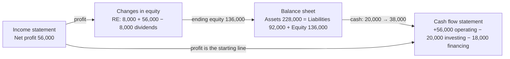

# The four statements and how they connect

In the first course you built a tiny income statement and balance sheet for Nour's bakery. Real companies publish **four** statements, and they fit together like gears.

| Statement | Question it answers | Covers |
|---|---|---|
| **Income statement** (statement of profit or loss) | Did we make a profit? | A period |
| **Balance sheet** (statement of financial position) | What do we own and owe? | One day |
| **Statement of changes in equity** | Why did the owners' stake change? | A period |
| **Cash flow statement** | Where did the cash come from and go? | A period |

Plus the **notes**: pages of detail and accounting choices that are part of the statements. Analysts often read the notes first.

## How they connect

- **Net profit** from the income statement goes into **retained earnings** in the statement of changes in equity.
- **Ending equity** appears on the balance sheet.
- The **change in cash** on the balance sheet is explained, line by line, by the cash flow statement.

## Our company for this course

We'll use one company throughout: **Green Valley Trading**, a shop that buys household goods from wholesalers and sells them to customers. Here are its 2025 numbers in short. Every later lesson opens one of these up.

**Income statement, year ended 31 Dec 2025**

| | |
|---|---|
| Net sales | 490,000 |
| Cost of goods sold | (294,000) |
| **Gross profit** | **196,000** |
| Operating expenses | (122,000) |
| **Operating profit** | **74,000** |
| Interest expense | (4,000) |
| Profit before tax | 70,000 |
| Income tax (20%) | (14,000) |
| **Net profit** | **56,000** |

**Balance sheet, 31 Dec**

| | 2025 | 2024 |
|---|---|---|
| Cash | 38,000 | 20,000 |
| Accounts receivable (net) | 45,000 | 38,000 |
| Inventory | 60,000 | 52,000 |
| Prepaid expenses | 5,000 | 4,000 |
| Equipment (net) | 80,000 | 70,000 |
| **Total assets** | **228,000** | **184,000** |
| Current liabilities | 52,000 | 46,000 |
| Long-term loan | 40,000 | 50,000 |
| Share capital | 80,000 | 80,000 |
| Retained earnings | 56,000 | 8,000 |
| **Total liabilities and equity** | **228,000** | **184,000** |

Notice: Green Valley made **56,000** profit but its cash only went up **18,000**. Where did the rest go? By Day 7 you'll be able to answer exactly.

## Companies vs sole owners

Green Valley is a **company**, so a few names change from the first course:

| Sole owner (Nour) | Company (Green Valley) |
|---|---|
| Capital | Share capital |
| Profit added to capital | Profit added to **retained earnings** |
| Drawings | **Dividends** |
| Statement of owner's equity | Statement of changes in equity |

## IFRS and GAAP

Most countries (including Egypt, the EU and the Gulf, with local versions) use **IFRS** (International Financial Reporting Standards). The US uses **US GAAP**. They agree on almost everything in this course. Where they differ (LIFO, for example) the lesson says so.
