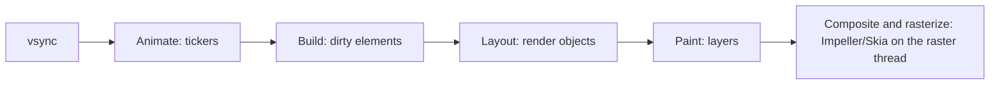

# Widgets, elements and render objects

| Tree | What | Lifetime |
|---|---|---|
| **Widget** | an immutable description (configuration) | rebuilt often, cheap |
| **Element** | the instance in the tree; holds state and the link between the other two | long-lived |
| **RenderObject** | does layout, painting and hit testing | long-lived, expensive |

When `build` returns a new widget, the element compares it with the old one: same **runtimeType** and **key** →
update the existing element and render object (`canUpdate`); otherwise throw the subtree away and create new ones.

`BuildContext` **is** the element. That's why `Theme.of(context)` works: it walks up the element tree.

## The pipeline for one frame

At 60 Hz you have about 16 ms per frame, shared between the UI thread (build, layout, paint) and the raster thread.

## State lifecycle

`createState` → `initState` → `didChangeDependencies` → `build` → (`didUpdateWidget` when the parent rebuilds with new
config) → `deactivate` → `dispose`. Start subscriptions in `initState`, read inherited widgets in
`didChangeDependencies`, cancel everything in `dispose`, and check `mounted` after an `await` before using `context`.
