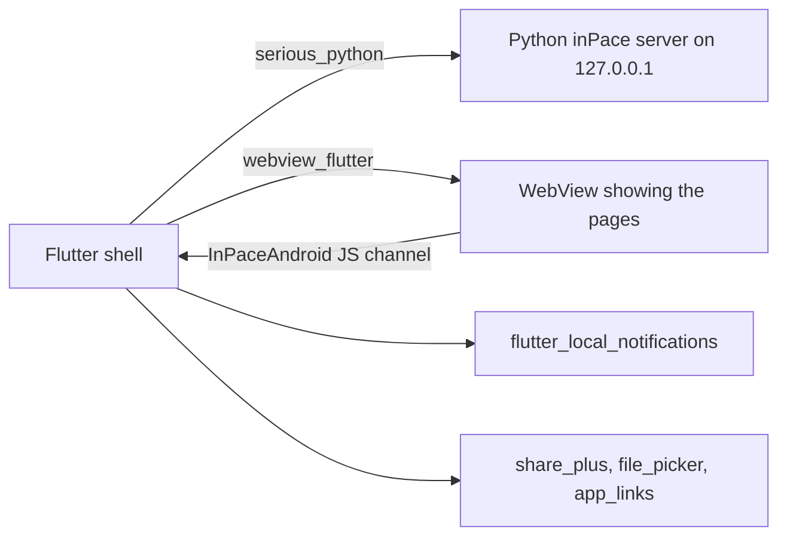

# A real hybrid: inPace's Android shell

inPace's phone app is an interesting architecture to discuss in interviews:



The page sends JSON messages to Flutter through a JavaScript channel:

```dart
controller.addJavaScriptChannel('InPaceAndroid', onMessageReceived: (m) => _fromPage(m.message));

Future<void> _fromPage(String raw) async {
  final Map<String, dynamic> msg = jsonDecode(raw);
  switch (msg['type']) {
    case 'download': await _download(msg['url'] as String);
    case 'share':    await Share.share(msg['text'] as String);
    case 'trip':     await Reminders.trip(msg['trip'] == null ? null : Map<String, dynamic>.from(msg['trip'] as Map));
  }
}
```

The navigation delegate keeps outside links out of the WebView:

```dart
onNavigationRequest: (request) {
  if (_isOurs(request.url)) return NavigationDecision.navigate;
  launchUrl(Uri.parse(request.url), mode: LaunchMode.externalApplication);
  return NavigationDecision.prevent;
},
```

And the focus timer becomes an **ongoing notification with a chronometer**: Android draws the countdown, so it keeps
going while the app is closed:

```dart
AndroidNotificationDetails(..., ongoing: true, showWhen: true,
    when: ends.millisecondsSinceEpoch, usesChronometer: true, chronometerCountDown: true)
```

**Trade-offs to discuss:** one codebase for desktop and phone, features ship everywhere at once; but the UI isn't
native widgets, start-up includes starting Python, and the bridge must be designed carefully (validate every message,
never let arbitrary pages call it).
