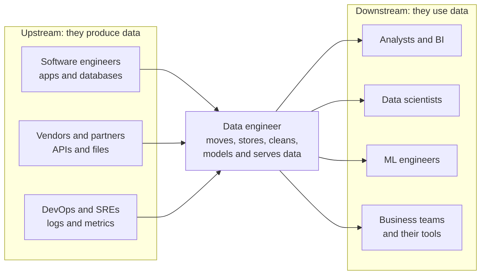

# The data engineer's job, on one page

## Where you sit

The most important skill in this picture isn't a tool. It's **talking to both sides**: knowing what upstream teams
are about to change in their systems before it breaks your pipelines, and knowing what downstream users actually
need before you build them something.

## What "good" looks like at each maturity stage

| Stage | The company... | Focus on | Avoid |
|---|---|---|---|
| **Starting with data** | has few goals, no real data team, reports from spreadsheets | Quick wins that show the value of data, talking to people, simple managed tools | Building a big custom platform nobody asked for |
| **Scaling with data** | has a data team and growing demands | Formal practices, scalable architecture, DataOps, documentation | Chasing the newest tool; becoming a team only you understand |
| **Leading with data** | is data-driven; data shapes products and decisions | Automation, self-service for others, data management and governance | Complacency, and expensive hobby projects |

## Type A or Type B?

| | Type A (abstraction) | Type B (build) |
|---|---|---|
| Builds by | assembling managed services and off-the-shelf tools | writing custom systems and tools |
| Found at | companies at every maturity stage | companies where data is a competitive edge (often stages 2 and 3) |
| Asks | "Can we buy or configure this?" | "Does building this give us an edge nobody can buy?" |

Most data engineers do both over a career. The book's advice holds either way: **avoid undifferentiated heavy
lifting**. Don't build what you can buy cheaply, unless building it is the business.

## The four primary languages

- **SQL**: the common language of databases, warehouses and lakes. You'll use it every day.
- **Python**: the glue between systems, and the bridge to data science.
- **A JVM language** (Java or Scala): what Spark, Kafka and much of the open source data world are written in.
- **bash**: the command line, for scripts, files and automation.

In this course, the projects use SQL and Python, which is where most data engineers start.

## What to take away

- You're the bridge between data producers and data consumers. Talk to both.
- "Good work" depends on the company's maturity: quick wins early, solid practices as it scales.
- Prefer simple, managed tools unless building gives a real edge.
