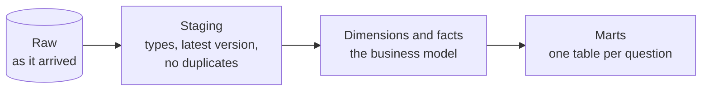
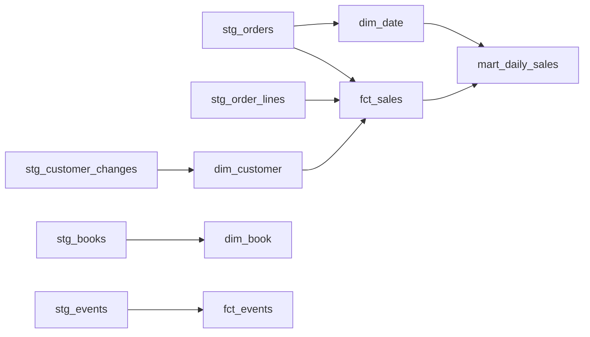
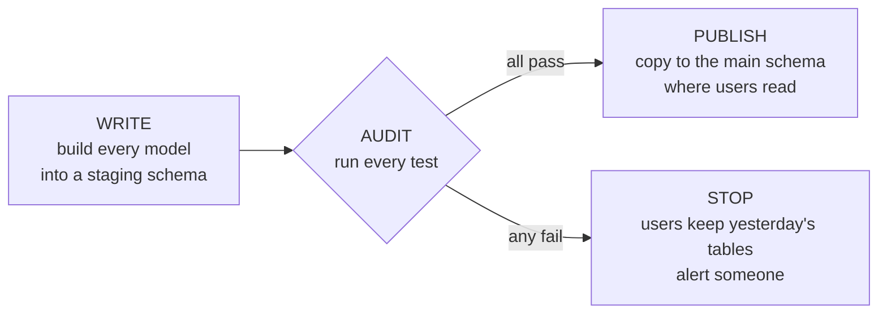

# Transformation pipelines: layers, a DAG, tests, and publishing safely

## Layers

| Layer | Rule | Inkwell |
|---|---|---|
| Raw | Never changed; rebuild everything from here | `lake/raw/...` |
| Staging | One model per source table; clean, don't add business logic | `stg_orders`, `stg_events` |
| Dimensions and facts | The business model, at a clear grain | `dim_customer`, `fct_sales` |
| Marts | What people and tools read | `mart_daily_sales` |

Tools like **dbt** organize SQL this way: one file per model, each a `SELECT`, with its dependencies declared. Today
you build a tiny version of that idea, so you'll recognize everything when you meet dbt (the library's *Data
engineering: building production pipelines* course uses it).

## A DAG of models

Each model names what it depends on. The runner sorts them so every model is built after its inputs: a **directed
acyclic graph** (DAG), the same idea orchestrators use for whole pipelines.

## Update patterns

| Pattern | How | Use when |
|---|---|---|
| **Truncate and reload** (full refresh) | Rebuild the whole table each run | Small tables; simplest and always consistent |
| **Insert only** (incremental) | Add only new rows | Big append-only data like events |
| **Upsert / merge** | Insert new keys, update existing ones | Big tables whose rows change |
| Delete | Remove rows (often "soft", with a flag) | Retention, privacy requests |

Inkwell rebuilds most models each run (they're small) and loads `fct_events` incrementally: only `event_id`s it hasn't
stored yet. Running it twice adds nothing.

## Data tests

A data test is a query that returns the rows that break a rule. **No rows = pass.**

| Test | Rule |
|---|---|
| Unique | `order_id` appears once in `stg_orders` |
| Not null | every sale found its customer version |
| Accepted values | status is one of placed, shipped, delivered, cancelled |
| Relationships | every sale's book exists in `dim_book` |
| Business rules | one current row per customer; no zero or negative amounts |

## Write, audit, publish

Without this, a bad load replaces good tables, and the owner's dashboard shows wrong numbers until someone notices.
With it, she sees yesterday's correct numbers and you get an alert.

## What to take away

- Raw, staging, model, marts: each layer has one job.
- Declare dependencies and let a DAG decide the order.
- Test the data, and publish only what passed.
