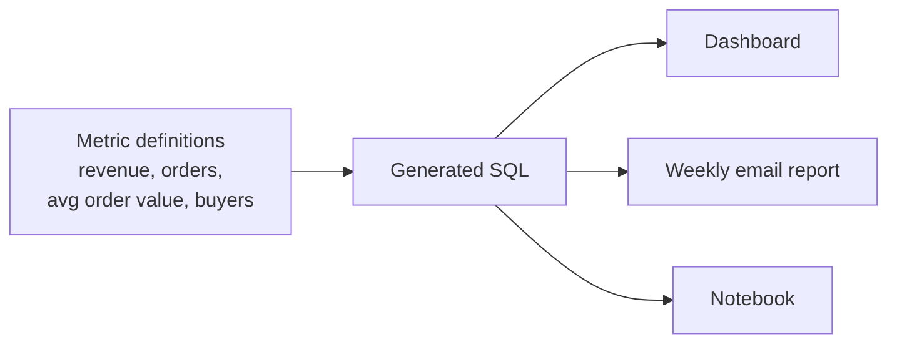

# Serving: one definition, many users

## Three kinds of users, three kinds of serving

| User | Wants | Inkwell | Watch out for |
|---|---|---|---|
| **People (analytics)** | Numbers they can trust, at the right time | The owner's sales dashboard | Two reports, two different revenues |
| **Models (machine learning)** | Clean features and labels, without peeking at the future | "Will this customer buy again?" | Data leakage: features built with data from after the prediction date |
| **Tools (reverse ETL)** | Data in their own format, in their own system | A win-back list for the email tool | Emailing closed accounts; feedback loops |

## The metrics layer

Without one, every dashboard writes its own SQL for "revenue". One forgets cancelled orders, another counts
shipping, and the meeting becomes an argument about whose number is right.



Each metric is written **once**, with a plain-language description, and every report asks for "metric by
dimension". Change the definition in one place and every report changes together. dbt's semantic layer, Cube and
LookML are real-world versions; today you build the idea in a Python dictionary.

## Point-in-time correctness

To train "will this customer buy again?", pick a **cutoff** date:

```text
            features come from here      |      the label comes from here
 Mar 1 ... ... ... ... ... ... ... Mar 5 | Mar 6 ... Mar 8
     orders, spend, favourite genre      |   did they order again?
```

If a feature uses anything after the cutoff, for example "total orders" counted over the whole week, the model learns
from the answer it's supposed to predict. It looks brilliant in testing and fails in real use. This is **data
leakage**, and preventing it is very much a data engineer's job.

## Reverse ETL

Analysts find the customers worth winning back; the marketing team works in an email tool, not in a warehouse.
Reverse ETL puts the list where they work, in the tool's own format (its column names, its file type or API). Rules:

- use **current** contact details, and never include closed or unsubscribed accounts;
- keep the list small and explainable: why is each person on it?
- watch for **feedback loops**: if the emails change behaviour, next week's list changes too. Measure it.

## A data product checklist

Before serving anything, write down: who uses it, for what decision, how fresh it must be, who owns its definitions,
how its quality is checked, and how a user reports a problem.

## What to take away

- Define metrics once and serve every report from that definition.
- Build ML features only from data before the cutoff.
- Reverse ETL puts data where people act on it; respect privacy and watch the loop.
