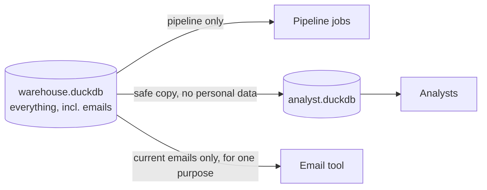

# Privacy and security habits for a data platform

## Personal data: four ways to protect it

| Technique | What it does | Can it be reversed? | Inkwell use |
|---|---|---|---|
| **Remove** | Don't copy the column at all | No | Analysts never get names |
| **Mask** | Show part of it: `m***@example.com` | No | Support screens |
| **Pseudonymize** (keyed hash) | Replace with a consistent code, using a secret key | Only with the key, by re-hashing known values | A customer ID analysts can count and join on |
| **Encrypt** | Scramble it with a key | Yes, with the key | Data that must be readable again later |

**Why a key matters.** A plain hash of an email (`sha256("laila@example.com")`) looks anonymous, but anyone with a list
of emails can hash them all and match. The book makes this point in the ingestion chapter. A keyed hash (**HMAC**,
or a hash with a secret **salt**) can't be matched without the key, and the key never leaves the pipeline.

## Least privilege, made concrete

Each user gets the smallest dataset that does the job. A database file per audience is the simplest version; real
warehouses do the same with roles, grants and views.

## Secrets stay out of code

- Keys and passwords come from **environment variables** or a secrets manager, never from a file in git.
- If a secret was ever committed, treat it as leaked: change it, even after deleting the line.
- A development default is fine only with a loud warning and never with real data.

## Backups you've tested

A backup you've never restored is a hope, not a backup. The habit: export, restore into an empty system, compare
(row counts at least), and keep a fixed number of copies (**retention**). Do it on a schedule, and keep one copy
somewhere ransomware on your main system can't reach.

## Orchestration: the last undercurrent

Running scripts by hand stops working on day two. An orchestrator (Airflow, Dagster, Prefect, or a simple scheduler
for now) runs the pipeline as a DAG of tasks:

| Feature | Why |
|---|---|
| Dependency order | Never build reports on data that failed to load |
| Retries with backoff | Most failures are temporary (a network blip) |
| Skip downstream on failure | Yesterday's correct numbers beat today's wrong ones |
| A record of every run | You can answer "did last night's run work?" in one line |
| An exit code | The scheduler (or you) knows something failed |

## What to take away

- Remove what users don't need; pseudonymize with a key what they need to count.
- Secrets live in the environment, not in code.
- Test restores. Orchestrate runs. Record every run.
