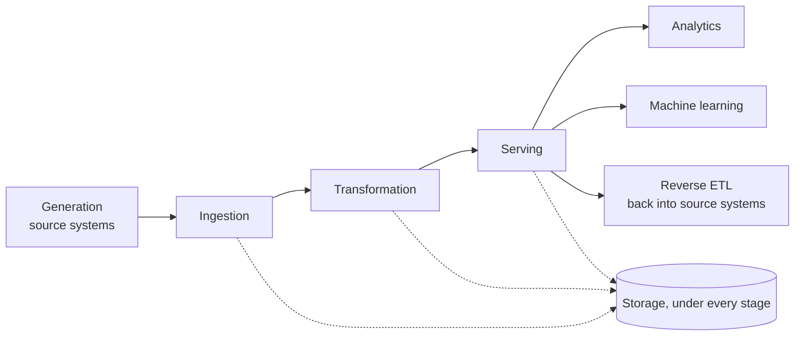

# The lifecycle and its undercurrents, as one picture

Under all of it: **security, data management, DataOps, data architecture, orchestration, software engineering.**

## The same stages, for Inkwell Books

| Stage | At Inkwell | What can go wrong |
|---|---|---|
| Generation | The shop's web app writes orders to its database; the website logs clicks | The app team renames a column without telling you |
| Ingestion | Copy new orders and clicks into the lake every night | A file arrives twice and sales are counted twice |
| Storage | Raw files in a lake, tables in a warehouse | Nobody can find which table is the right one |
| Transformation | Clean, join and model the data into "sales per day" | Cancelled orders counted as sales |
| Serving | A dashboard for the owner, a list for the email tool | Two reports show two different revenues |

## Undercurrents, made concrete

| Undercurrent | One practical habit |
|---|---|
| Security | Give each person and job only the access it needs (least privilege). Keep secrets out of code. |
| Data management | Check data quality on the way in; document what each table and column means. |
| DataOps | Automate runs, log every run, alert on failures, and know what you'll do when one breaks. |
| Data architecture | Choose components you can change later. |
| Orchestration | Run steps in dependency order; don't build a report on data that failed to load. |
| Software engineering | Version control, tests and code review for pipelines too. |

## Data quality, in three words

- **Accurate**: the data is correct (no test orders, no bots counted as customers).
- **Complete**: nothing is missing (every store's sales arrived).
- **Timely**: it's there when people need it (yesterday's sales by 8 a.m.).

## Batch or streaming?

Streaming sounds modern, and the book is clear that it comes at a cost: more complex systems, harder testing,
always-on infrastructure. Ask: **what decision gets better if the data is seconds old instead of hours?** If nobody
can answer, use batch. Inkwell's owner looks at sales once a day, so its pipeline is batch.

## What to take away

- Each lifecycle stage has its own failure modes; the undercurrents are how you prevent them.
- Quality means accurate, complete and timely.
- Streaming needs a business reason.
