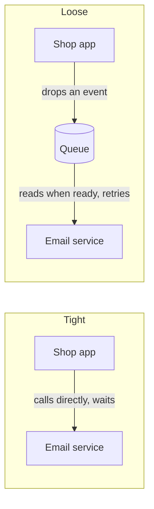

# Architecture ideas you'll use every week

## Plan for failure: four numbers to agree on

| Term | Plain meaning | Inkwell example |
|---|---|---|
| **Availability** | Share of time the system is up | The dashboard is up 99% of the time |
| **Reliability** | Chance it does its job correctly when used | The nightly load finishes with correct numbers |
| **Recovery time objective (RTO)** | Longest outage the business can accept | The dashboard can be down for a day; checkout can't be down for 5 minutes |
| **Recovery point objective (RPO)** | Most data the business can afford to lose | Losing one night's load is fine, it can be re-run |

Agree on these with the business **before** choosing tools. A one-day RTO and a five-minute RTO lead to very
different designs and very different bills.

## Tight versus loose coupling



In the tight design, when the email service is down, **orders fail**. In the loose design, orders keep working, and
emails go out later. The cost: one more component (the queue), and the consumer must handle **duplicates**, because
queues and retries can deliver the same message twice. That's today's project.

## Reversible decisions

- **Two-way door**: easy to undo. Trying a new dashboard tool on one team. Decide fast.
- **One-way door**: hard or impossible to undo. Signing a five-year licence, deleting the raw data after loading it.
  Slow down, write it down, get a second opinion.

A practical trick: keep raw data in open formats (CSV, JSON, Parquet) in cheap storage. Then even a wrong tool choice
later stays a two-way door, because you can reload everything into something else.

## Architecture types, by the problem they solve

| Architecture | Problem it solves | Watch out for |
|---|---|---|
| Data warehouse | One trusted, structured place for analytics | Rigid; slow to add new data |
| Data lake | Store any data cheaply, decide the use later | Becomes a "data swamp" without management |
| Lakehouse | Lake storage with warehouse features (tables, transactions) | Newer tooling |
| Lambda | Fast streaming results plus correct batch results | Two code paths that must agree |
| Kappa | One streaming backbone for everything | Reprocessing history through a stream is hard and costly |
| Data mesh | A central data team becomes a bottleneck in a big company | Needs mature domain teams and a good platform |

## Write it down: an architecture decision record

Teams record important decisions in short documents called **architecture decision records** (ADRs): what you
decided, why, what else you considered, and what would make you change your mind. They make decisions reversible in
practice, because a future colleague can see *why* something is the way it is.

```markdown
# ADR 1: Store raw data as files in a lake before loading the warehouse

Status: accepted, 2026-03-01
Context: Inkwell has one database and one event log; reports need history the app overwrites.
Decision: Land every source as Parquet files in the lake's raw zone, unchanged. Build the warehouse from there.
Alternatives: load the warehouse straight from the app database (simpler, but no raw history to rebuild from).
Consequences: one more storage layer to manage; any warehouse can be rebuilt from raw files.
Revisit if: data volume makes file storage costs matter, or a managed tool replaces the whole pipeline.
```

## What to take away

- Agree on RTO and RPO first; they shape the design.
- Loose coupling trades a little complexity for a lot of resilience, and brings duplicates you must handle.
- Make two-way-door decisions quickly; slow down for one-way doors and write them down.
