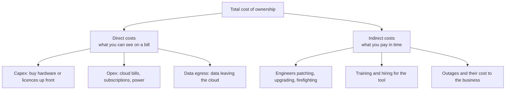

# A checklist for choosing a data tool

When someone asks "should we use X?", go through these questions in order. Most bad choices skip the first three.

| # | Question | Why it matters |
|---|---|---|
| 1 | What problem, for whom, by when? | A tool without a use case is a hobby |
| 2 | Can our team run it? | A tool nobody can operate becomes the bottleneck |
| 3 | What does it cost over 3 years, including our time (TCO)? | People are usually the biggest cost |
| 4 | What can't we do if we pick it (TOCO)? | Lock-in, and the work you won't get to |
| 5 | Does it connect to what we have? | Interoperability saves months of glue code |
| 6 | Is it immutable or transitory? | Build on what will last; keep the rest replaceable |
| 7 | Where does it run, and where does the data travel? | Egress fees and latency |
| 8 | Build, open source, or buy? | Build only where it's your competitive edge |
| 9 | How do we leave it? | Every choice should have an exit |

## Costs: what goes into TCO

**FinOps** is the habit of treating the cloud bill as something engineers watch and design for, not something
finance discovers at the end of the month. In practice: tag resources by team and project, set budgets and alerts,
and look at the cost of a pipeline next to its run time.

## Serverless, containers or servers?

| | Serverless | Containers | Servers (VMs) |
|---|---|---|---|
| You manage | Only your code | Your code and image | Everything above the hardware |
| Best for | Small, simple, spiky tasks | Many services, steady load | Special needs, full control |
| Cost grows with | Number and length of calls | Cluster size | Machine size, always on |
| Watch out for | Time and memory limits, cost at high volume | Kubernetes complexity | Patching and idle cost |

## Cloud networking in one minute

- A **region** is a geographic location; it contains several **availability zones** (separate data centres).
  Spread across zones to survive one failing.
- Moving data **into** the cloud is usually cheap or free; moving it **out** (egress), and often **between zones and regions**, costs money per
  gigabyte. Keep compute near the data, and watch dashboards that download large results every few minutes.

## What to take away

- Ask about the problem, the team and the 3-year cost before the features.
- Serverless fits small spiky jobs; steady heavy work fits containers or servers.
- Egress fees are a design input, not a surprise.
